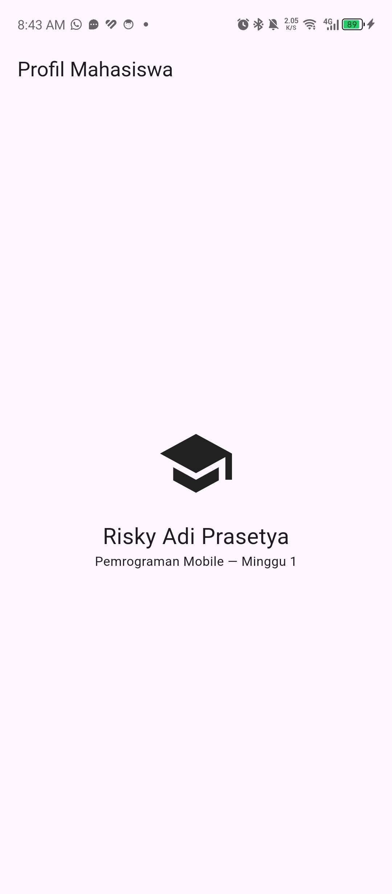
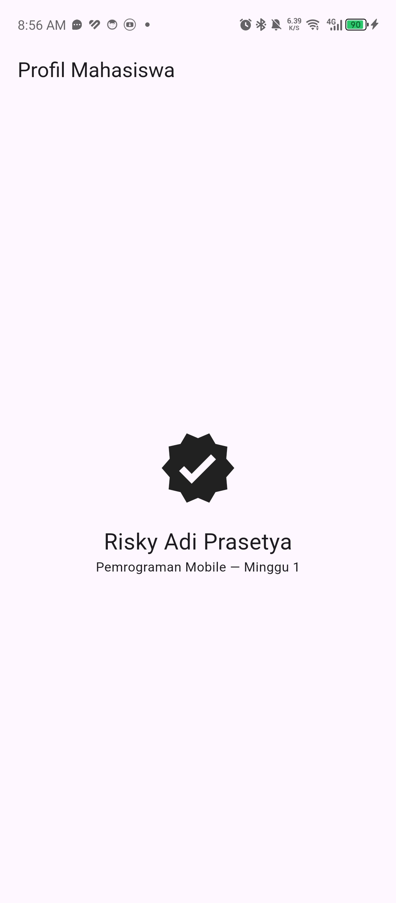
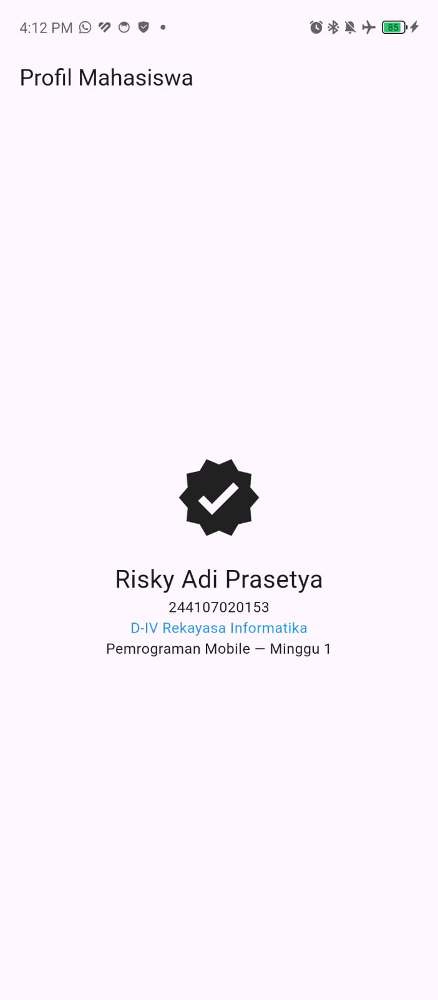
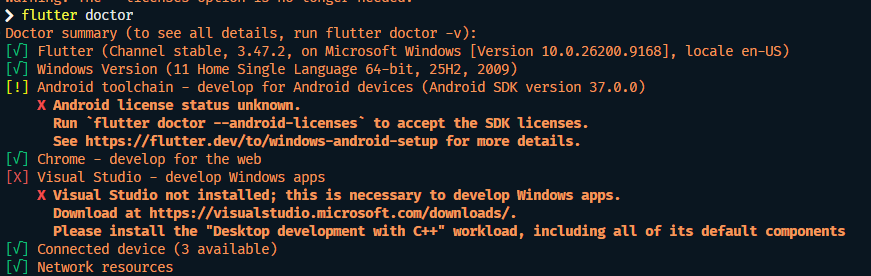

# Week 01 - Mobile Development Ecosystem Flutter Refresh

<p align="left">
  
  
  
</p>

- **Nama** : Risky Adi Prasetya
- **NIM** : 244107020153
- **Program Studi** : Teknik Informatika
- **Kelas** : TI- 3E

## Tujuan

Tujuan dari praktikum minggu pertama adalah memahami Ekosistem Mobile dan pendekatannya, memahami basic arsitektur Flutter, peran Dart, struktur proyek, dan widget tree, memahami basic Dart, dan mempersiapkan kebutuhan environtment untuk pembuatan aplikasi pertama.

## Fitur Utama

Fitur utama dalam praktikum minggu ini adalah bisa menampilkan beberapa informasi pengguna, namun masih bersifat manual by code.

## Tech Stack

- **Framework:** Flutter & Dart
- **IDE:** VS Code
- **Device:** Handphone
- **Version Control:** Github

## How to

Berikut adalah cara menjalankan project ini dengan metode **perangkat fisik:**

```bash
# 1. Lakukan clone/pull repositori
git pull https://github.com/rsyadipras/244107020153-mobile-course.git

# 2. Masuk ke dalam folder minggu ini
cd 01-week-1-mobile-development-ecosystem-flutter-refresh/

# 3. Pastikan Perangkat Fisik sudah terhubung menggunakan kabel data, dan sudah mengaktifkan mode usb debugging pada Developer Options

# 4. Jalankan aplikasi
flutter run
```

## Hasil

Praktikum ini menghasilkan tampilan UI sederhana.

<p align="center">
  
</p>
<p align="center">
<i>Hasil pertama menggunakan hot reload.</i><br>
<i>(Hot reload: input perubahan kode tanpa hapus state)</i>
</p>
<p align="center">
  
</p>
<p align="center"><i>Hasil kedua: Perubahan pada icon dari hasil pertama, menggunakan hot restart.</i><br>
<i>(Hot Restart: restart aplikasi secara keseluruhan dan memulai dari awal, baik digunakan ketika hot reload tidak berfungsi)</i>
</p>

---

## Mini Assigment

Mini assignment tetap menggunakan project yang sama, namun terdapat beberapa modifikasi tambahan berupa informasi NIM dan Program Studi.

```dart
Text('244107020153'), // Penambahan NIM
Text('D-IV Rekayasa Informatika', style: TextStyle(color: Colors.blue), ), // Penambahan Prodi
```

Kode program keseluruhan dapat dilihat pada folder `lib/main.dart` atau seperti di bawah ini:

```dart
class MyApp extends StatelessWidget {
  const MyApp({super.key});

  @override
  Widget build(BuildContext context) {
    return MaterialApp(
      debugShowCheckedModeBanner: false,
      home: Scaffold(
        appBar: AppBar(title: const Text('Profil Mahasiswa')),
        body: const Center(
          child: Column(
            mainAxisSize: MainAxisSize.min,
            children: [
              Icon(Icons.verified, size: 72), // Perubahan Icon
              SizedBox(height: 16),
              Text(
                'Risky Adi Prasetya',
                style: TextStyle(fontSize: 24),
              ), // Perubahan Nama
              Text('244107020153'), // Penambahan NIM
              Text(
                'D-IV Rekayasa Informatika',
                style: TextStyle(color: Colors.blue),
              ), // Penambahan Prodi
              Text('Pemrograman Mobile — Minggu 1'),
            ],
          ),
        ),
      ),
    );
  }
}
```

Dan hasilnya adalah sebagai berikut:

<p align="center">
  
</p>

### Kendala

Terdapat kendala setup pada konfigurasi flutter ketika melihat `flutter doctor` yang error, seperti pada gambar di bawah ini:

<p align="center">
  
</p>

ketika dilakukan `flutter doctor --android-licenses` tetap tidak bisa/error, dan menghasilkan output berupa SDKManager mengalami _deprecated_.

**Solusi:** mengubah versi `Android SDK Command-line Tools` dari yang saat ini digunakan ke satu versi sebelumnya.

---

## Reflection

**1. Kapan native lebih tepat dipilih daripada cross-platform?**

- Native lebih tepat dipilih ketika aplikasi membutuhkan performa maksimal atau akses mendalam ke fitur spesifik platform yang belum tentu didukung penuh oleh framework cross-platform. Penggunaan native dan cross-platform juga tergantung terhadap keahlian tim, biaya, dan target platform.

**2. Bagaimana perubahan state berhubungan dengan widget tree dan UI deklaratif?**

- Dalam Flutter, UI adalah fungsi dari state sehingga saat state berubah, Flutter melakukan rebuild pada widget tree, lalu hanya update bagian render yang benar-benar berubah.

**3. Mengapa commit kecil dengan pesan jelas bermanfaat bagi pekerjaan tim dan portfolio?**

- Commit kecil dengan pesan yang jelas memudahkan tim dalam melakukan review kode, mengurangi risiko konflik saat merge, dan dalam portofolio bisa mencerminkan pribadi yang disiplin dan berpikir secara terstruktur.
