# Week 02 - Declarative and UI Responsive Design
<p align="left">
  
  
  
</p>

| | |
|---|---|
| **Nama** | Risky Adi Prasetya |
| **NIM** | 244107020153 |
| **Program Studi** | Teknik Informatika |
| **Kelas** | TI-3E |

## Daftar Isi

- [Tujuan](#tujuan)
- [Fitur Utama](#fitur-utama)
- [Tech Stack](#tech-stack)
- [How to](#how-to)
- [Praktikum Layout Sederhana Warm-up](#praktikum-layout-sederhana-warm-up)
- [Praktikum: Dashboard Responsif](#praktikum-dashboard-responsif)
- [Tugas dan AI Design Exploration](#tugas-dan-ai-design-exploration)
- [Refactoring Challenge](#refactoring-challenge)
- [Reflection](#reflection)

---

## Tujuan
- Memahami prinsip declarative UI dan hubungan antara widget, konfigurasi, serta state.
- Menggunakan `StatelessWidget`, `StatefulWidget`, `Container`, `Row`, `Column`, dan `Expanded`.
- Membedakan komponen Material 3 dan Cupertino untuk kebutuhan platform yang berbeda.
- Membangun layout responsif untuk ukuran layar mobile dan tablet.
- Menerapkan theme, dark mode, styling, dan aksesibilitas dasar.

## Fitur Utama
- Header profil mahasiswa berisi nama, NIM, prodi, dan minggu perkuliahan.
- Empat kartu informasi (Assignments, Attendance, Portfolio, Current week) yang memakai satu widget reusable, `InfoCard`.
- Layout responsif: satu kolom pada layar sempit dan dua kolom pada layar lebar (breakpoint `700`).
- Light theme dan dark theme berbasis Material 3 dengan toggle `CupertinoSwitch`, dan warna yang mengikuti `ColorScheme`.
- Aksesibilitas dasar seperti label `Semantics` pada header, kartu, dan tombol tema, serta `ExcludeSemantics` agar teks tidak dibaca dua kali.

## Tech Stack

| Komponen | Detail |
|---|---|
| Framework | Flutter & Dart |
| IDE | VS Code |
| Device | Smartphone Infinix |
| Version Control | GitHub |

---

## How to

Berikut cara menjalankan project ini dengan metode **perangkat fisik**:

```bash
# 1. Lakukan clone/pull repositori
git pull https://github.com/rsyadipras/244107020153-mobile-course.git

# 2. Masuk ke dalam folder minggu ini
cd 02-week-2-declarative-ui-responsive-design

# 3. Pastikan perangkat fisik sudah terhubung menggunakan kabel data,
#    dan mode USB debugging sudah aktif pada Developer Options

# 4. Jalankan aplikasi
flutter run
```

---

## Praktikum Layout Sederhana Warm-up

### Kode Program

```dart
import 'package:flutter/material.dart';

void main() => runApp(const ProfileApp());

class ProfileApp extends StatelessWidget {
  const ProfileApp({super.key});

  @override
  Widget build(BuildContext context) {
    return const MaterialApp(
      debugShowCheckedModeBanner: false,
      home: Scaffold(body: Center(child: ProfileCard())),
    );
  }
}

class ProfileCard extends StatelessWidget {
  const ProfileCard({super.key});

  @override
  Widget build(BuildContext context) {
    return Container(
      width: 320,
      padding: const EdgeInsets.all(16),
      decoration: BoxDecoration(
        color: Colors.indigo.shade50,
        borderRadius: BorderRadius.circular(16),
      ),
      child: Column(
        mainAxisSize: MainAxisSize.min,
        children: [
          Row(
            children: [
              const CircleAvatar(child: Icon(Icons.person)),
              const SizedBox(width: 12),
              Expanded(
                child: Column(
                  crossAxisAlignment: CrossAxisAlignment.start,
                  children: const [
                    Text(
                      'Nama Mahasiswa',
                      style: TextStyle(fontWeight: FontWeight.bold),
                    ),
                    Text('Risky Adi Prasetya'),
                  ],
                ),
              ),
            ],
          ),
          const SizedBox(height: 12),
          const Row(
            children: [
              Expanded(child: Text('NIM')),
              Text('244107020153'),
            ],
          ),
          const Row(
            children: [
              Expanded(child: Text('Kelas')),
              Text('TI - 3E'),
            ],
          ),
          const Row(
            children: [
              Expanded(child: Text('Email')),
              Text('244107020153@student.polinema.ac.id'),
            ],
          ),
        ],
      ),
    );
  }
}
```

<p align="center">
  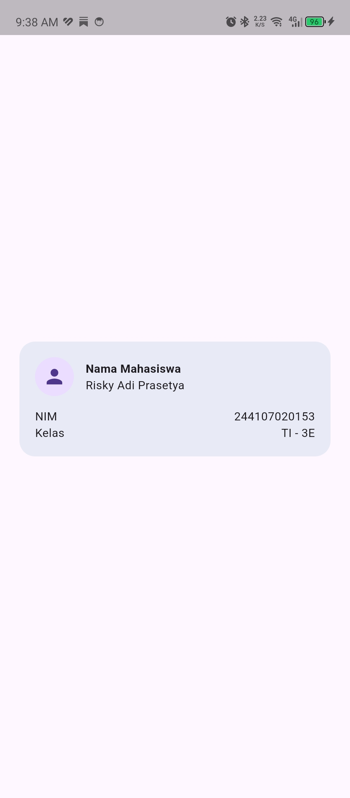
  <br>
  <i>Tampilan default warm-up</i>
</p>

### Eksperimen Warm-up

#### 1. Hapus `Expanded` pada baris nama

Hapus `Expanded` pada baris nama, amati peringatan overflow atau perilaku layout-nya, lalu kembalikan setelah itu.

```dart
// ...
child: Column(
  mainAxisSize: MainAxisSize.min,
  children: [
    Row(
      children: [
        const CircleAvatar(child: Icon(Icons.person)),
        const SizedBox(width: 12),
        // Expanded( -> dihapus untuk mengetahui efeknya
        Column(
          crossAxisAlignment: CrossAxisAlignment.start,
          children: const [
            Text(
              'Nama Mahasiswa',
              style: TextStyle(fontWeight: FontWeight.bold),
            ),
            Text('Risky Adi Prasetyassssssssssssssssssssssssssssssss'),
          ],
        ),
        // ),
      ],
    ),
// ...
```

<p align="center">
  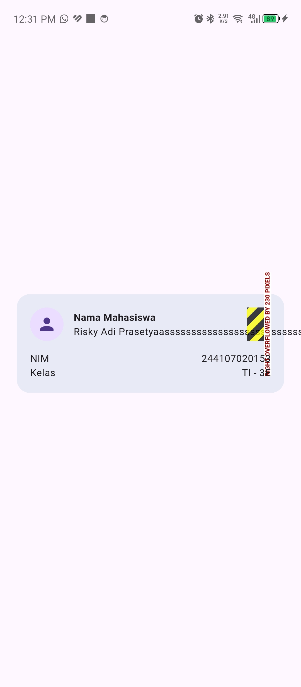
  <br>
  <i>Efek menghapus <code>Expanded</code></i>
</p>

#### 2. Ubah `mainAxisSize` ke nilai default

Ganti `mainAxisSize: MainAxisSize.min` menjadi nilai default dan amati perubahan tinggi kartu.

```dart
// ...
child: Column(
  // mainAxisSize: MainAxisSize.min, -> diganti ke nilai default
  children: [
    Row(
      children: [
        const CircleAvatar(child: Icon(Icons.person)),
        const SizedBox(width: 12),
        Expanded(
          child: Column(
            crossAxisAlignment: CrossAxisAlignment.start,
            children: const [
              Text(
                'Nama Mahasiswa',
                style: TextStyle(fontWeight: FontWeight.bold),
              ),
              Text('Risky Adi Prasetya'),
            ],
          ),
        ),
      ],
    ),
// ...
```

<p align="center">
  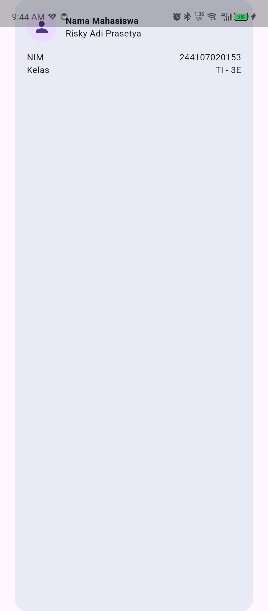
  <br>
  <i>Efek mengubah <code>mainAxisSize</code></i>
</p>

#### 3. Tambahkan baris data Email

Tambahkan satu baris data (misal Email) menggunakan pola `Row` + `Expanded` yang sama.

```dart
// ...
const Row(
  children: [
    Expanded(child: Text('Kelas')),
    Text('TI - 3E'),
  ],
),
const Row(
  children: [
    Expanded(child: Text('Email')),
    Text('244107020153@student.polinema.ac.id'), // Penambahan Email
  ],
),
// ...
```

<p align="center">
  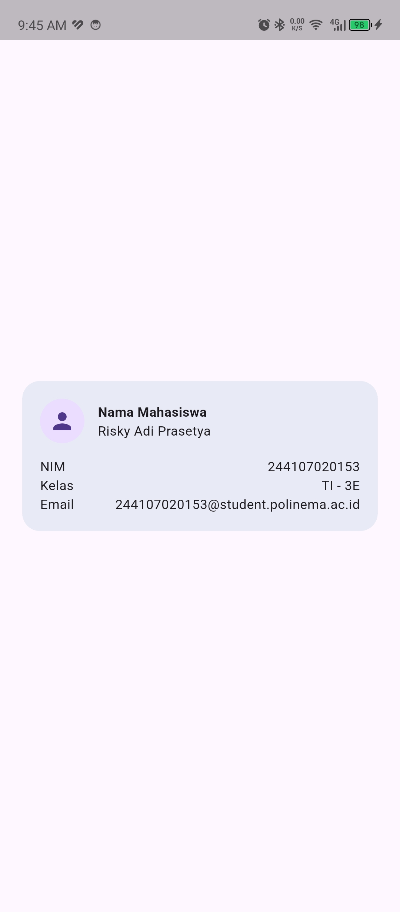
  <br>
  <i>Tampilan setelah menambah baris email</i>
</p>

---

## Praktikum: Dashboard Responsif

### Menyiapkan Project

```dart
import 'package:flutter/material.dart';

void main() => runApp(const DashboardApp());

class DashboardApp extends StatelessWidget {
  const DashboardApp({super.key});

  @override
  Widget build(BuildContext context) {
    return MaterialApp(
      debugShowCheckedModeBanner: false,
      theme: ThemeData(useMaterial3: true, colorSchemeSeed: Colors.indigo),
      darkTheme: ThemeData(
        useMaterial3: true,
        brightness: Brightness.dark,
        colorSchemeSeed: Colors.indigo,
      ),
      themeMode: ThemeMode.system,
      home: const DashboardPage(),
    );
  }
}

class DashboardPage extends StatelessWidget {
  const DashboardPage({super.key});

  @override
  Widget build(BuildContext context) {
    return Scaffold(
      appBar: AppBar(title: const Text('Student Dashboard')),
      body: LayoutBuilder(
        builder: (context, constraints) {
          final columns = constraints.maxWidth >= 700 ? 2 : 1;
          return GridView.count(
            padding: const EdgeInsets.all(16),
            crossAxisCount: columns,
            crossAxisSpacing: 16,
            mainAxisSpacing: 16,
            childAspectRatio: 2.6,
            children: const [
              DashboardCard(title: 'Assignments', value: '8'),
              DashboardCard(title: 'Attendance', value: '92%'),
              DashboardCard(title: 'Portfolio', value: 'Ready'),
              DashboardCard(title: 'Current week', value: '02'),
            ],
          );
        },
      ),
    );
  }
}

class DashboardCard extends StatelessWidget {
  const DashboardCard({required this.title, required this.value, super.key});
  final String title;
  final String value;

  @override
  Widget build(BuildContext context) {
    return Card(
      child: Padding(
        padding: const EdgeInsets.all(20),
        child: Row(children: [
          Expanded(child: Text(title)),
          Text(value, style: Theme.of(context).textTheme.headlineSmall),
        ]),
      ),
    );
  }
}
```

<p align="center">
  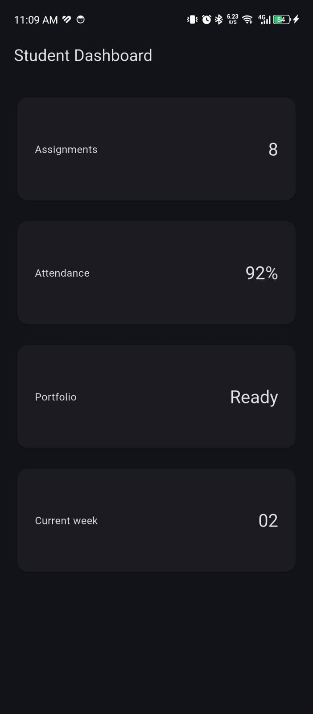
  <br>
  <i>Hasil persiapan project awal Dashboard Responsive</i>
</p>

### Menambahkan Interaksi: StatefulWidget dan Cupertino

```dart
class DashboardApp extends StatefulWidget {
  const DashboardApp({super.key});

  @override
  State<DashboardApp> createState() => _DashboardAppState();
}

class _DashboardAppState extends State<DashboardApp> {
  bool isDark = false;

  @override
  Widget build(BuildContext context) {
    return MaterialApp(
      debugShowCheckedModeBanner: false,
      theme: ThemeData(useMaterial3: true, colorSchemeSeed: Colors.indigo),
      darkTheme: ThemeData(
        useMaterial3: true,
        brightness: Brightness.dark,
        colorSchemeSeed: Colors.indigo,
      ),
      themeMode: isDark ? ThemeMode.dark : ThemeMode.light,
      home: DashboardPage(
        isDark: isDark,
        onDarkChanged: (value) => setState(() => isDark = value),
      ),
    );
  }
}
```

```dart
class DashboardPage extends StatelessWidget {
  const DashboardPage({
    required this.isDark,
    required this.onDarkChanged,
    super.key,
  });
  final bool isDark;
  final ValueChanged<bool> onDarkChanged;

  @override
  Widget build(BuildContext context) {
    return Scaffold(
      appBar: AppBar(
        title: const Text('Student Dashboard'),
        actions: [
          Row(
            children: [
              Icon(isDark ? Icons.dark_mode : Icons.light_mode),
              const SizedBox(width: 4),
              CupertinoSwitch(
                value: isDark,
                onChanged: onDarkChanged,
              ),
              const SizedBox(width: 12),
            ],
          ),
        ],
      ),
      body: LayoutBuilder(
        // ... kode GridView sebelumnya, tidak berubah
      ),
    );
  }
}
```

<p align="center">
  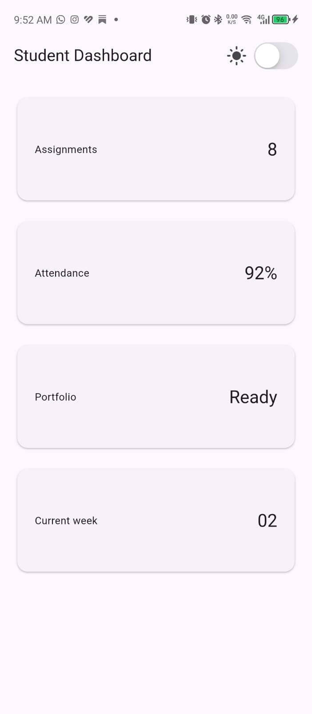
  <br>
  <i>Dashboard dengan toggle tema (<code>CupertinoSwitch</code>)</i>
</p>

### Eksperimen Layout

#### 1. Ubah breakpoint

Ubah breakpoint dari `700` menjadi nilai lain dan amati perubahan jumlah kolom.

```dart
// ...
body: LayoutBuilder(
  builder: (context, constraints) {
    final columns = constraints.maxWidth >= 300 ? 2 : 1; // ubah 700 -> 300
    return GridView.count(
      padding: const EdgeInsets.all(16),
      crossAxisCount: columns,
      crossAxisSpacing: 16,
      mainAxisSpacing: 16,
      childAspectRatio: 2.6,
      children: const [
        DashboardCard(title: 'Assignments', value: '8'),
        DashboardCard(title: 'Attendance', value: '92%'),
        DashboardCard(title: 'Portfolio', value: 'Ready'),
        DashboardCard(title: 'Current week', value: '02'),
      ],
    );
  },
),
// ...
```

<p align="center">
  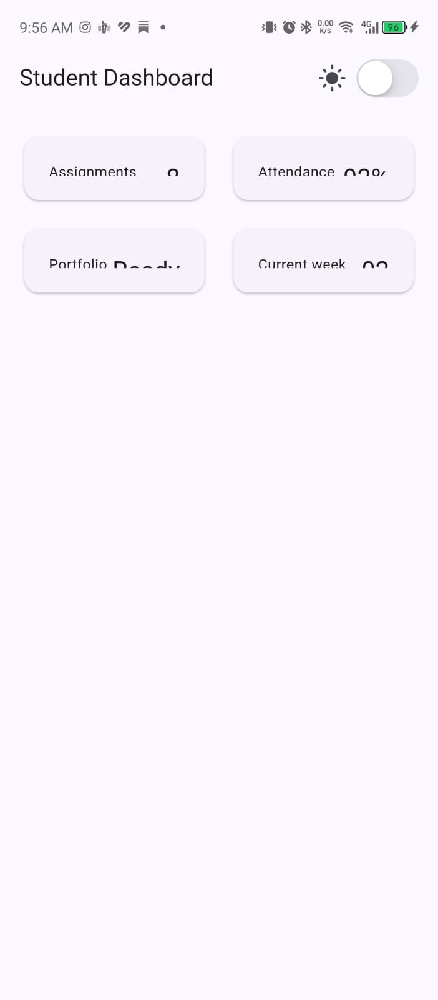
  <br>
  <i>Efek mengubah breakpoint dari 700 ke 300</i>
</p>

#### 2. Ubah `themeMode`

Ubah `themeMode` menjadi `ThemeMode.dark`, lalu kembalikan ke `ThemeMode.system`.

```dart
// ...
Widget build(BuildContext context) {
  return MaterialApp(
    debugShowCheckedModeBanner: false,
    theme: ThemeData(useMaterial3: true, colorSchemeSeed: Colors.indigo),
    darkTheme: ThemeData(
      useMaterial3: true,
      brightness: Brightness.dark,
      colorSchemeSeed: Colors.indigo,
    ),
    themeMode: ThemeMode.system, // diubah dari ThemeMode.dark ke ThemeMode.system
    home: DashboardPage(
      isDark: isDark,
      onDarkChanged: (value) => setState(() => isDark = value),
    ),
  );
}
// ...
```

<p align="center">
  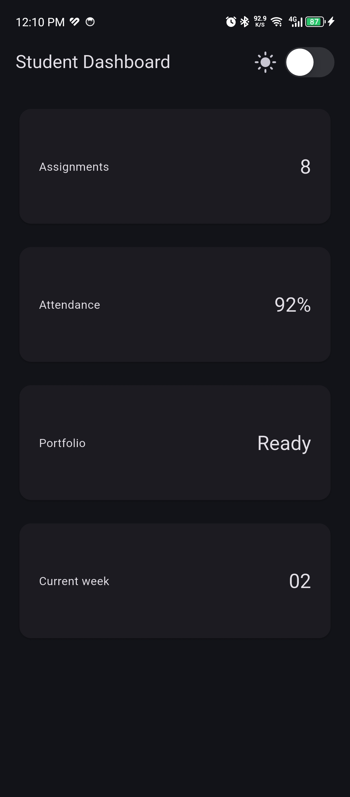
  <br>
  <i>Efek mengubah <code>ThemeMode.dark</code> ke <code>ThemeMode.system</code></i>
</p>

#### 3. Uji pada ukuran layar emulator yang berbeda

<p align="center">
  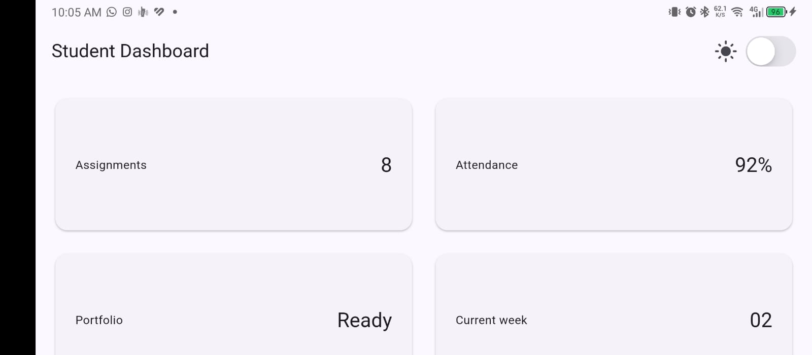
  <br>
  <i>Hasil pengujian pada ukuran layar emulator yang berbeda</i>
</p>

#### 4. Tambahkan `Semantics`

Tambahkan `Semantics` atau label yang bermakna pada elemen penting bagi screen reader.

```dart
// ...
Widget build(BuildContext context) {
  return Scaffold(
    appBar: AppBar(
      title: const Text('Student Dashboard'),
      actions: [
        Row(
          children: [
            ExcludeSemantics(
              child: Icon(isDark ? Icons.dark_mode : Icons.light_mode),
            ),
            const SizedBox(width: 4),
            Semantics(
              // Penambahan Semantics
              label: 'Mode Gelap',
              hint: 'Ketuk sekali untuk beralih antara mode terang dan gelap',
              value: isDark ? 'Aktif' : 'Tidak aktif',
              child: CupertinoSwitch(value: isDark, onChanged: onDarkChanged),
            ),
            const SizedBox(width: 12),
          ],
        ),
      ],
    ),
// ...
```

```dart
// ...
Widget build(BuildContext context) {
  return Card(
    child: Semantics(
      // Penambahan Semantics
      label: '$title, nilainya adalah $value',
      container: true,
      child: Padding(
        padding: const EdgeInsets.all(20),
        child: Row(
          children: [
            // ExcludeSemantics agar teks di dalamnya tidak dibaca dua kali
            Expanded(child: ExcludeSemantics(child: Text(title))),
            ExcludeSemantics(
              child: Text(
                value,
                style: Theme.of(context).textTheme.headlineSmall,
              ),
            ),
          ],
        ),
      ),
    ),
  );
}
// ...
```

---

## Tugas dan AI Design Exploration

### Tugas Utama

Pengembangan dashboard menjadi **Academic Overview**, dengan penambahan profile header dan minimal 4 kartu informasi.

```dart
// Penambahan header profil
class ProfileHeader extends StatelessWidget {
  const ProfileHeader({super.key});

  @override
  Widget build(BuildContext context) {
    final scheme = Theme.of(context).colorScheme;
    return Semantics(
      container: true,
      label:
          'Profil mahasiswa. Nama Risky Adi Prasetya. NIM 244107020153. Program studi D-IV Rekayasa Informatika.',
      child: ExcludeSemantics(
        child: Container(
          margin: const EdgeInsets.fromLTRB(16, 16, 16, 0),
          padding: const EdgeInsets.all(20),
          decoration: BoxDecoration(
            color: scheme.primaryContainer,
            borderRadius: BorderRadius.circular(20),
          ),
          child: Row(
            children: [
              Icon(Icons.verified, size: 56, color: scheme.onPrimaryContainer),
              const SizedBox(width: 16),
              Expanded(
                child: Column(
                  crossAxisAlignment: CrossAxisAlignment.start,
                  children: [
                    Text(
                      'Risky Adi Prasetya',
                      style: TextStyle(
                        fontSize: 22,
                        fontWeight: FontWeight.bold,
                        color: scheme.onPrimaryContainer,
                      ),
                    ),
                    Text(
                      '244107020153',
                      style: TextStyle(color: scheme.onPrimaryContainer),
                    ),
                    Text(
                      'D-IV Rekayasa Informatika',
                      style: TextStyle(color: scheme.onPrimaryContainer),
                    ),
                    Text(
                      'Pemrograman Mobile — Minggu 2',
                      style: TextStyle(color: scheme.onPrimaryContainer),
                    ),
                  ],
                ),
              ),
            ],
          ),
        ),
      ),
    );
  }
}
```

```dart
// ...
body: LayoutBuilder(
  builder: (context, constraints) {
    final columns = constraints.maxWidth >= 700 ? 2 : 1;
    // header profil di atas, grid kartu di bawah
    return Column(
      children: [
        const ProfileHeader(),
        Expanded(
          child: GridView.count(
            padding: const EdgeInsets.all(16),
            crossAxisCount: columns,
            crossAxisSpacing: 16,
            mainAxisSpacing: 16,
            childAspectRatio: 2.6,
            children: const [
              DashboardCard(title: 'Assignments', value: '8'),
              DashboardCard(title: 'Attendance', value: '92%'),
              DashboardCard(title: 'Portfolio', value: 'Ready'),
              DashboardCard(title: 'Current week', value: '02'),
            ],
          ),
        ),
      ],
    );
  },
),
// ...
```

<p align="center">
  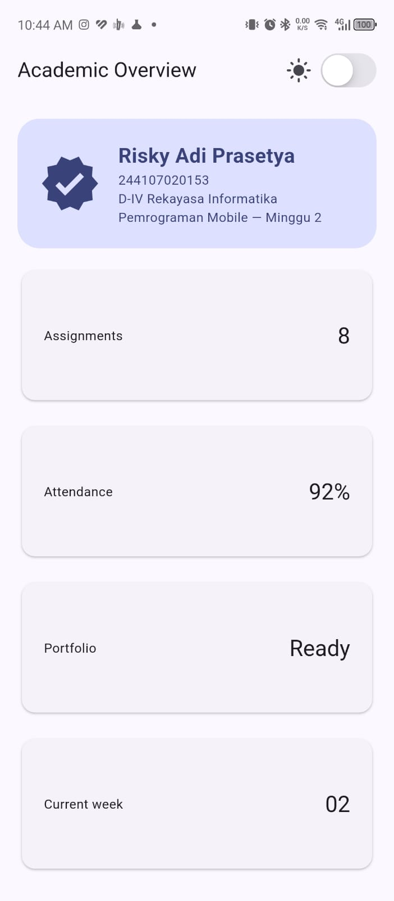
</p>
<p align="center">
  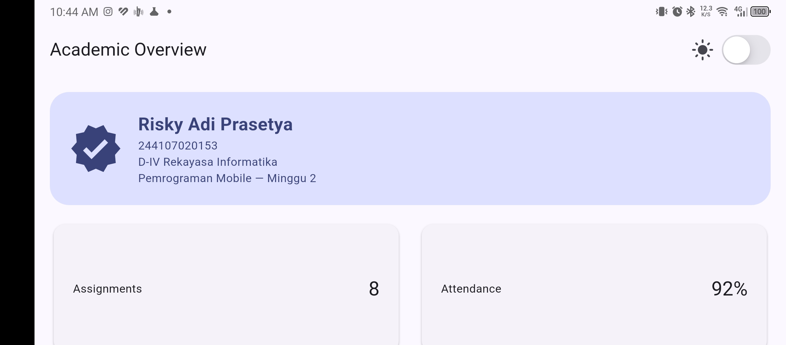
  <br>
  <i>Tampilan header profil pada mode portrait dan landscape</i>
</p>

### AI Prompt Challenge

#### 1. Prompt Desain

```text
Bandingkan dua tata letak dashboard akademik untuk Flutter: versi GridView dan versi LayoutBuilder + Column. Jelaskan trade-off responsif dan aksesibilitasnya.
```

**Jawab:**

<p align="center">
  <video src="screenshots/gridview.mp4" width="75%" autoplay loop muted playsinline></video>
  <br>
  <i>Versi <code>LayoutBuilder</code> + <code>GridView</code></i>
</p>

<p align="center">
  <video src="screenshots/layoutbuilder-column.mp4" width="75%" autoplay loop muted playsinline></video>
  <br>
  <i>Versi <code>LayoutBuilder</code> + <code>Column</code></i>
</p>

**Trade-off responsif**

- `GridView` mudah dipakai karena jumlah kolom cukup diatur lewat satu angka. Kelemahannya, tinggi kartu ikut lebar layar. Di layar lebar kartu jadi terlalu tinggi, dan di layar sempit isinya bisa terpotong.
- `Column` + `Row` lebih fleksibel karena tinggi kartu menyesuaikan isi, namun kodenya lebih panjang.

**Trade-off aksesibilitas**

- Pengguna yang memperbesar ukuran font bisa membuat teks di `GridView` terpotong, karena tinggi kartunya tetap.
- `Column` + `Row` aman untuk font besar karena kartu ikut membesar.
- Untuk screen reader keduanya sama, selama `Semantics` dipasang.

---

#### 2. Prompt Penguatan Konsep

```text
Jelaskan kapan penggunaan Expanded justru menyebabkan overflow di dalam Row, beri contoh kode yang gagal dan perbaikannya.
```

**Jawab:**

`Expanded` membagi ruang kosong di dalam `Row` kepada child. Namun, `Expanded` tidak dapat membuat isi child menjadi lebih kecil dari ukuran minimumnya. Karena itu, overflow masih dapat terjadi jika child berisi teks panjang yang tidak boleh wrap, atau jika `Row` berada di dalam parent dengan lebar tak terbatas.

**Contoh yang gagal:**

```dart
SizedBox(
  width: 220,
  child: Row(
    children: [
      const Expanded(child: Text('Email')),
      Expanded(
        child: Text(
          '244107020153@student.polinema.ac.id',
          maxLines: 1,
          softWrap: false,
          overflow: TextOverflow.visible,
        ),
      ),
    ],
  ),
)
```

Pada contoh tersebut, setiap `Expanded` hanya mendapat sebagian dari lebar `220` pixel, sedangkan teks email dipaksa tetap satu baris dan tetap terlihat utuh. Akibatnya, teks melampaui batas kanan `Row` dan Flutter menampilkan peringatan **RenderFlex overflowed**.

**Perbaikan:** izinkan teks membungkus atau potong dengan ellipsis.

```dart
SizedBox(
  width: 220,
  child: Row(
    children: [
      const Expanded(child: Text('Email')),
      Expanded(
        child: Text(
          '244107020153@student.polinema.ac.id',
          maxLines: 1,
          overflow: TextOverflow.ellipsis,
        ),
      ),
    ],
  ),
)
```

Alternatifnya, gunakan `Flexible` jika child tidak harus mengambil seluruh ruang yang tersedia. Selain itu, jangan menempatkan `Expanded` di dalam `Row` yang berada pada `SingleChildScrollView` horizontal tanpa memberi lebar terbatas, karena parent tersebut memberikan constraint lebar tak terbatas. Dalam kondisi itu Flutter dapat menampilkan error _non-zero flex but incoming width constraints are unbounded_. Berikan lebar yang jelas, atau gunakan child biasa tanpa `Expanded`.

---

#### 3. Verification Prompt

```text
Periksa kembali rekomendasi layout di atas: apakah tetap responsif di bawah 600px, apakah mengurangi aksesibilitas, dan apakah ada widget yang tidak tersedia di Flutter stabil saat ini?
```

**Jawab:**

**Hasil verifikasi**

- **Responsif di bawah 600px:** Rekomendasi tetap responsif karena breakpoint `700` membuat `GridView` menggunakan satu kolom pada layar sempit. `Expanded` pada header dan kartu memberi sisa ruang kepada teks sehingga teks dapat membungkus.
- **Aksesibilitas:** Penggunaan `Semantics` pada switch dan kartu sudah membantu screen reader, sedangkan `ExcludeSemantics` mencegah pembacaan ganda. Pastikan label tetap bermakna, kontrol switch dapat dijangkau dengan keyboard atau aksesibilitas perangkat, dan teks tidak hanya dibedakan dengan warna.
- **Ketersediaan widget:** `LayoutBuilder`, `GridView`, `Expanded`, `Flexible`, `Semantics`, `ExcludeSemantics`, `CupertinoSwitch`, dan `TextOverflow.ellipsis` tersedia di Flutter stable. `CupertinoSwitch` bukan bagian dari import Material secara langsung, sehingga file yang memakainya harus menambahkan:

  ```dart
  import 'package:flutter/cupertino.dart';
  ```

---

## Refactoring Challenge

### 1. Ekstrak kartu informasi menjadi widget reusable

Ekstrak kartu informasi menjadi widget reusable (misal `InfoCard`) yang menerima `title` dan `value`, sehingga tidak ada duplikasi widget.

- `DashboardCard` diganti nama menjadi `InfoCard` dan hanya menerima `title` dan `value`. Keempat kartu memakai widget yang sama.
- Data profil di `ProfileHeader` dijadikan `static const` (`name`, `nim`, `prodi`, `course`), jadi tiap teks hanya ditulis sekali dan dipakai ulang di label `Semantics`.
- Warna teks header (`onPrimaryContainer`) dulu diulang di setiap `Text`. Sekarang diatur sekali lewat `DefaultTextStyle.merge`.

### 2. Ganti nilai hardcode dengan `Theme.of(context)`

Ganti warna dan ukuran yang di-hardcode dengan `Theme.of(context)` agar mengikuti tema terang/gelap secara otomatis.

- Ukuran font `22` diganti `textTheme.titleLarge`.
- Judul kartu memakai `bodyLarge` berwarna `onSurfaceVariant`, dan nilainya memakai `headlineSmall` berwarna `primary`.
- Semua warna header dan kartu berasal dari `colorScheme`, jadi ikut berubah saat tema terang atau gelap.
- Konfigurasi `ThemeData` yang tadinya ditulis dua kali kini dibuat oleh satu fungsi `buildTheme(Brightness)`. Warna seed `Colors.indigo` menjadi `kSeedColor`.

### 3. Pindahkan breakpoint ke konstanta bernama

Pindahkan breakpoint ke satu konstanta bernama (misal `const kWideBreakpoint = 700;`) agar hanya didefinisikan satu kali.

- `kWideBreakpoint = 700` dipakai di satu tempat: `constraints.maxWidth >= kWideBreakpoint`.
- Saya juga menamai `kCardAspectRatio`, `kPagePadding`, dan `kHeaderIconSize` agar angka-angka layout tidak tersebar.

### 4. Jalankan `flutter analyze`

Pastikan tidak ada error maupun warning baru.

<p align="center">
  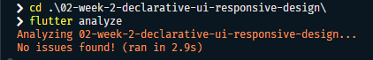
  <br>
  <i>Hasil <code>flutter analyze</code></i>
</p>

---
## Testing Dasar
Widget test berada di folder `test/` dan memverifikasi perilaku responsif dashboard dengan mengubah ukuran layar lewat `tester.view`.

| Test | Ukuran layar | Ekspektasi |
|---|---|---|
| Dashboard satu kolom di layar sempit | `400 x 800` | Lebar kartu `< 700` |
| Dashboard dua kolom di layar lebar | `1200 x 800` | Lebar kartu `> 500` |

```dart
import 'package:flutter/material.dart';
import 'package:flutter_test/flutter_test.dart';
import 'package:responsive_dashboard/main.dart';

void main() {
  testWidgets('Dashboard satu kolom di layar sempit', (tester) async {
    tester.view.physicalSize = const Size(400, 800);
    tester.view.devicePixelRatio = 1.0;
    addTearDown(tester.view.reset);

    await tester.pumpWidget(const DashboardApp());

    final width = tester.getSize(find.byType(Card)).width;
    expect(width, lessThan(700));
  });

  testWidgets('Dashboard dua kolom di layar lebar', (tester) async {
    tester.view.physicalSize = const Size(1200, 800);
    tester.view.devicePixelRatio = 1.0;
    addTearDown(tester.view.reset);

    await tester.pumpWidget(const DashboardApp());

    final width = tester.getSize(find.byType(Card)).width;
    expect(width, greaterThan(500));
  });
}
```

Jalankan dengan:

```bash
flutter test
```

<p align="center">
  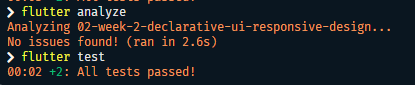
  <br>
  <i>Hasil <code>flutter test</code>: kedua test lulus</i>
</p>

---
## Reflection

**1. Apa perbedaan cara berpikir imperative dan declarative saat membangun UI?**

Imperative berfokus pada langkah-langkah untuk mengubah UI, misalnya mencari widget lalu mengubah propertinya satu per satu. Declarative berfokus pada hasil UI yang diinginkan berdasarkan state saat ini. Pada Flutter, perubahan state memicu `build()` untuk menggambar ulang widget sesuai kondisi terbaru.

**2. Kapan `Expanded` membantu dan kapan penggunaannya justru menghasilkan layout error?**

`Expanded` membantu membagi sisa ruang pada `Row` atau `Column`, terutama ketika teks perlu menyesuaikan lebar yang tersedia. Namun, error dapat terjadi jika child memiliki isi yang tidak bisa mengecil, seperti teks satu baris tanpa overflow handling, atau jika `Expanded` berada di dalam parent dengan constraint pada sumbu utama yang tidak terbatas.

**3. Bagaimana breakpoint dan theme memengaruhi pengalaman pengguna?**

Breakpoint menentukan kapan layout berubah dari satu kolom menjadi dua kolom, sehingga konten lebih mudah dibaca pada layar kecil maupun besar. Theme menjaga warna, kontras, tipografi, dan tampilan terang atau gelap tetap konsisten. Keduanya perlu diuji pada beberapa ukuran layar dan kondisi tema.

**4. Apa yang Anda verifikasi dari rekomendasi AI setelah tugas inti selesai?**

Layout tetap menggunakan satu kolom di bawah `600px`, semantics tersedia untuk screen reader, widget yang digunakan tersedia di Flutter stable, dan sudah menjalankan `flutter analyze` dan widget test untuk memastikan perubahan breakpoint serta ukuran `card` bekerja sesuai harapan.