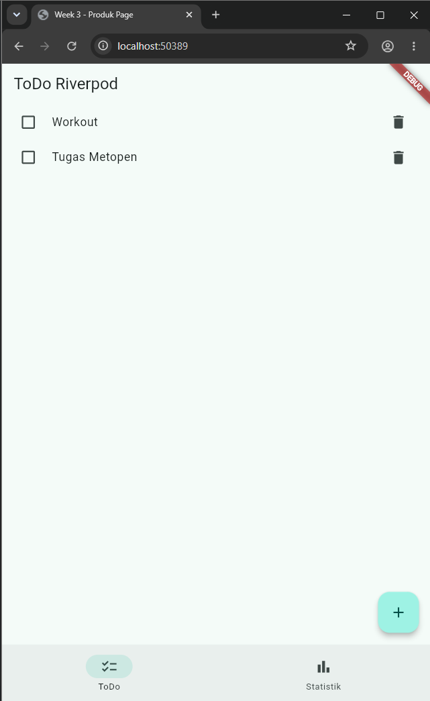
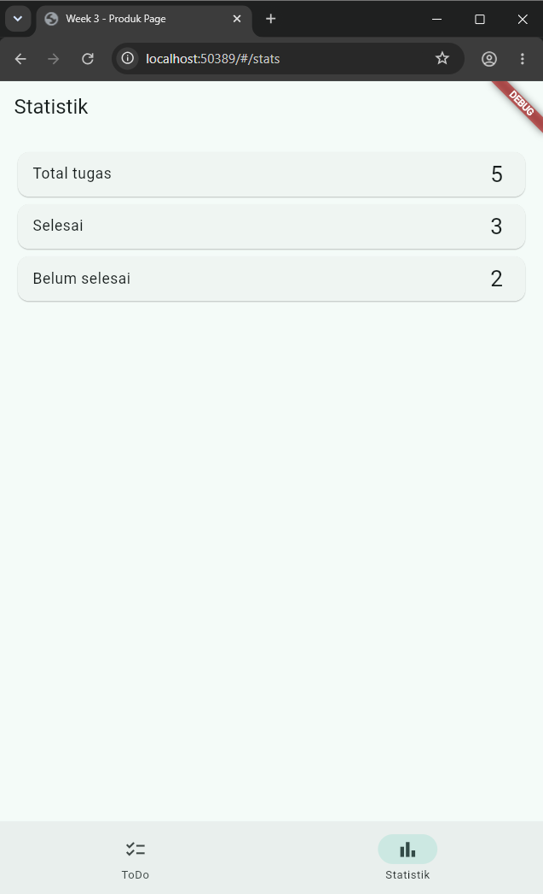
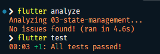

# Week 03 — Navigation & State Management

<p align="left">
  
  
  
  
  
</p>

> Dokumentasi praktikum Pemrograman Mobile — Minggu 3

| Informasi         | Detail             |
| ----------------- | ------------------ |
| **Nama**          | Risky Adi Prasetya |
| **NIM**           | 244107020153       |
| **Program Studi** | Teknik Informatika |
| **Kelas**         | TI-3E              |

## Daftar Isi

- [Tujuan Pembelajaran](#tujuan-pembelajaran)
- [Struktur Folder](#struktur-folder)
- [Aplikasi Multi-page dengan GoRouter](#aplikasi-multi-page-dengan-gorouter)
- [To-Do State Management dengan Riverpod](#ToDo---state-management-dengan-riverpod)
- [AsyncValue: Loading, Error, Success](#asyncvalue-loading-error-success)
- [Praktikum 3 — Uji Ketiga State](#praktikum-3--uji-ketiga-state)
- [AI Challenge](#ai-challenge)
- [Refactoring dan Testing](#refactoring-dan-testing)
- [Tugas, Refleksi, dan Referensi](#tugas-dan-refleksi)

---

## Tujuan Pembelajaran

- menjelaskan konsep navigasi, route, dan perbedaan Navigator 1.0 dengan GoRouter;
- menerapkan navigasi multi-page dengan GoRouter, termasuk passing argument dan deep link sederhana;
- menjelaskan mengapa state management diperlukan dan cara kerja Riverpod (`Provider`, `ConsumerWidget`, `Notifier`);
- menggunakan `AsyncValue` untuk menangani state loading, error, dan success pada UI;
- membangun aplikasi ToDo dengan navigasi dan Riverpod, lalu memverifikasi hasilnya dengan widget test sederhana.

## Tech Stack

| Komponen        | Detail             |
| --------------- | ------------------ |
| Framework       | Flutter & Dart     |
| IDE             | VS Code            |
| Device          | Smartphone Infinix |
| Version Control | GitHub             |

## Struktur Folder

Struktur folder yang digunakan untuk tugas minggu ini:

```text
03-week-3-navigation-state-management/
├── 03-navigation/
│   ├── lib/
│   │   ├── main.dart
│   │   └── pages/
│   │       ├── home_page.dart
│   │       └── detail_page.dart
│   ├── test/
│   ├── screenshots/
│   └── README.md
├── 03-state-management/
└── 03-week-3-navigation-state-management/
```

---

## Aplikasi Multi-page dengan GoRouter

### Membuat Project

```bash
flutter create week3_navigation
cd week3_navigation
flutter pub add go_router
```

### 1. Definisikan Router

File: `lib/main.dart`

```dart
import 'package:flutter/material.dart';
import 'package:go_router/go_router.dart';
import 'pages/detail_page.dart';
import 'pages/home_page.dart';

void main() => runApp(const MyApp());

final _router = GoRouter(
  initialLocation: '/',
  routes: [
    GoRoute(
      path: '/',
      builder: (context, state) => const HomePage(),
      routes: [
        GoRoute(
          path: 'detail/:id',
          builder: (context, state) => DetailPage(
            id: state.pathParameters['id']!,
          ),
        ),
      ],
    ),
  ],
);

class MyApp extends StatelessWidget {
  const MyApp({super.key});

  @override
  Widget build(BuildContext context) {
    return MaterialApp.router(
      title: 'Week 3 - Navigation',
      routerConfig: _router,
      theme: ThemeData(
        colorSchemeSeed: Colors.indigo,
        useMaterial3: true,
      ),
    );
  }
}
```

### 2. Halaman Home

File: `lib/pages/home_page.dart`

```dart
import 'package:flutter/material.dart';
import 'package:go_router/go_router.dart';

class HomePage extends StatelessWidget {
  const HomePage({super.key});

  @override
  Widget build(BuildContext context) {
    return Scaffold(
      appBar: AppBar(title: const Text('Home')),
      body: ListView.builder(
        itemCount: 10,
        itemBuilder: (context, index) => ListTile(
          title: Text('Item ${index + 1}'),
          onTap: () => context.go('/detail/${index + 1}'),
        ),
      ),
    );
  }
}
```

### 3. Halaman Detail

File: `lib/pages/detail_page.dart`

```dart
import 'package:flutter/material.dart';

class DetailPage extends StatelessWidget {
  final String id;

  const DetailPage({super.key, required this.id});

  @override
  Widget build(BuildContext context) {
    return Scaffold(
      appBar: AppBar(title: Text('Detail $id')),
      body: Center(
        child: Text('Anda membuka item dengan id: $id'),
      ),
    );
  }
}
```

### 4. Hasil

**Hasil Implementasi:**

<p align="center">
  <video src="03-navigation\screenshots\nav-goRouter.mp4" width="40%" autoplay loop muted playsinline></video>
  <br>
  <i>Hasil navigasi + <code>GoRouter</code></i>
</p>

<p align="center">
  <video src="03-navigation\screenshots\nav-goRouter-mobile.mp4" width="40%" autoplay loop muted playsinline></video>
  <br>
  <i>Hasil navigasi + <code>GoRouter</code> versi Mobile</i>
</p>

## ToDo - State Management dengan Riverpod

### Membuat Project

```bash
flutter create week3_todo
cd week3_todo
flutter pub add flutter_riverpod
```

### 1. ProviderScope

File: `lib/main.dart`

```dart
import 'package:flutter/material.dart';
import 'package:flutter_riverpod/flutter_riverpod.dart';
import 'pages/todo_page.dart';

void main() => runApp(const ProviderScope(child: MyApp()));

class MyApp extends StatelessWidget {
  const MyApp({super.key});

  @override
  Widget build(BuildContext context) => MaterialApp(
        title: 'Week 3 - ToDo',
        theme: ThemeData(
          colorSchemeSeed: Colors.teal,
          useMaterial3: true,
        ),
        home: const TodoPage(),
      );
}
```

### 2. State dan Provider

File: `lib/providers/todo_provider.dart`

```dart
import 'package:flutter_riverpod/flutter_riverpod.dart';

class Todo {
  Todo(this.title, {this.done = false});

  final String title;
  final bool done;

  Todo copyWith({String? title, bool? done}) =>
      Todo(title ?? this.title, done: done ?? this.done);
}

class TodoListNotifier extends Notifier<List<Todo>> {
  @override
  List<Todo> build() => const [];

  void add(String title) => state = [...state, Todo(title)];

  void toggle(int index) {
    final todos = [...state];
    todos[index] = todos[index].copyWith(done: !todos[index].done);
    state = todos;
  }

  void remove(int index) => state = [...state]..removeAt(index);
}

final todoListProvider =
    NotifierProvider<TodoListNotifier, List<Todo>>(TodoListNotifier.new);
```

> State tidak boleh diubah langsung dengan `state.add(...)`. Selalu buat list baru agar Riverpod mendeteksi perubahan dan UI melakukan rebuild.

### 3. ConsumerWidget

File: `lib/pages/todo_page.dart`

```dart
import 'package:flutter/material.dart';
import 'package:flutter_riverpod/flutter_riverpod.dart';
import '../providers/todo_provider.dart';

class TodoPage extends ConsumerWidget {
  const TodoPage({super.key});

  @override
  Widget build(BuildContext context, WidgetRef ref) {
    final todos = ref.watch(todoListProvider);

    return Scaffold(
      appBar: AppBar(title: const Text('ToDo Riverpod')),
      body: todos.isEmpty
          ? const Center(child: Text('Belum ada tugas'))
          : ListView.builder(
              itemCount: todos.length,
              itemBuilder: (context, index) => ListTile(
                leading: Checkbox(
                  value: todos[index].done,
                  onChanged: (_) =>
                      ref.read(todoListProvider.notifier).toggle(index),
                ),
                title: Text(
                  todos[index].title,
                  style: TextStyle(
                      decoration: todos[index].done
                          ? TextDecoration.lineThrough
                          : null),
                ),
                trailing: IconButton(
                  icon: const Icon(Icons.delete),
                  onPressed: () =>
                      ref.read(todoListProvider.notifier).remove(index),
                ),
              ),
            ),
      floatingActionButton: FloatingActionButton(
        onPressed: () => _showAddDialog(context, ref),
        child: const Icon(Icons.add),
      ),
    );
  }

  void _showAddDialog(BuildContext context, WidgetRef ref) {
    final controller = TextEditingController();
    showDialog(
      context: context,
      builder: (context) => AlertDialog(
        title: const Text('Tugas baru'),
        content: TextField(controller: controller, autofocus: true),
        actions: [
          TextButton(
            onPressed: () => Navigator.pop(context),
            child: const Text('Batal'),
          ),
          FilledButton(
            onPressed: () {
              if (controller.text.trim().isNotEmpty) {
                ref
                    .read(todoListProvider.notifier)
                    .add(controller.text.trim());
              }
              Navigator.pop(context);
            },
            child: const Text('Tambah'),
          ),
        ],
      ),
    );
  }
}
```

### Hasil implementasi:

  <p align="center">
    <video src="03-state-management/screenshots/state-management.mp4" width="50%" autoplay loop muted playsinline></video>
    <br>
    <i>Hasil state management + <code>Riverpod</code></i>
  </p>

## AsyncValue: Loading, Error, Success

1. Salin kode `AsyncNotifier` ke project ToDo atau project terpisah.
2. Jalankan aplikasi dan amati loading selama dua detik pertama.
3. Ubah `build()` sementara untuk melempar error: `throw Exception('Gagal terhubung ke server');`.
4. Amati UI error dan tombol **Coba lagi**.
5. Pulihkan kode, tekan **Coba lagi**, lalu pastikan state success tampil.

### Hasil Implementasi:

  <p align="center">
    <video src="03-state-management/screenshots/first-test-async.mp4" width="50%" autoplay loop muted playsinline></video>
    <br>
    <i>Hasil testing pertama async value</i>
  </p>

  <p align="center">
    <video src="03-state-management/screenshots/err-build.mp4" width="50%" autoplay loop muted playsinline></video>
    <br>
    <i>Hasil throw error build</i>
  </p>

  <p align="center">
    <video src="03-state-management/screenshots/ref-validate-test.mp4" width="95%" autoplay loop muted playsinline></video>
    <br>
    <i>Hasil refresh validation test</i>
  </p>

> Menampilkan data lama (stale data) dengan indikator refresh jauh lebih baik daripada mengosongkan layar karena pengguna bisa mengetahui apa yang sedang terjadi semisal terdapat data baru yang sedang diunduh, atau koneksi yang terputus, dsb. Pola ini sangat penting diterapkan pada fitur seperti timeline media sosial, dashboard statistik, dan kondisi aplikasi dengan jaringan yang kurang stabil agar pengguna tidak dihadapkan pada layar loading kosong yang membingungkan.

## AI Challenge

### AI Prompt Challenge

Prompt AI :

```text
Buatkan halaman Flutter bernama StatsPage menggunakan flutter_riverpod.
Requirements:
- ConsumerWidget dengan satu AsyncNotifierProvider yang mensimulasikan
  pengambilan data statistik (delay 2 detik, kadang gagal 30%).
- UI harus menangani loading (spinner), error (pesan + tombol retry),
  dan success (ListView 3 item).
- Berikan unit test untuk notifier-nya.
Jelaskan setiap bagian kode dalam komentar.
```

### AI Verification Checklist

Verifikasi implementasi AI pada folder [`03-ai-prompt/`](03-ai-prompt/):

| No. | Pemeriksaan                                                                   | Status | Keterangan                                                                                                                           |
| :-: | ----------------------------------------------------------------------------- | :----: | ------------------------------------------------------------------------------------------------------------------------------------ |
|  1  | Apakah state diubah secara immutable (tidak ada state.add() atau mutasi list langsung)?                                         | Lulus  | Tidak ada `state.add()` atau mutasi list langsung.                                                                                   |
|  2  | Apakah `ref.watch` hanya dipakai di dalam build, dan `ref.read` di callback? | Lulus  | `ref.watch` digunakan di `build`. Callback retry menggunakan `ref.invalidate(statsProvider)` untuk memuat ulang provider.            |
|  3  | Apakah ketiga state AsyncValue benar-benar ditangani (bukan hanya success)?                                     | Lulus  | State `loading`, `error`, dan `data` ditangani melalui `AsyncValue.when`.                                                            |
|  4  | Apakah provider dideklarasikan dengan tipe eksplisit dan tidak duplikat dengan provider lain?                   | Lulus  | Menggunakan satu `AsyncNotifierProvider<StatsNotifier, List<Statistic>>`.                                                            |
|  5  | Apakah kode AI memakai API Riverpod versi lama (`StateProvider` antipattern, `StateNotifierProvider` usang, atau `Consumer` bertingkat yang tidak perlu)? Perbaiki ke pola Notifier/ConsumerWidget.                                  | Lulus  | Menggunakan `AsyncNotifier`, `AsyncNotifierProvider`, dan `ConsumerWidget`, bukan `StateProvider` atau `StateNotifierProvider` lama. |
|  6  | Jalankan `flutter analyze` dan `flutter test`, apakah hasil AI lolos tanpa warning?                              | Lulus  | `flutter analyze` menghasilkan **No issues found** dan `flutter test` menghasilkan **All tests passed**.                             |

### Dokumentasi AI

Artefak dalam folder `docs/`:
| Dokumen | Lokasi |
| --- | --- |
| Prompt yang digunakan | [`docs/ai-prompt.md`](docs/ai-prompt.md) |
| Output awal AI | [`docs/ai-output-awal.md`](docs/ai-output-awal.md) |
| Hasil testing | [`docs/ai-testing.md`](docs/ai-testing.md) |

## Refactoring dan Testing

### Refactoring Challenge
1. Pisahkan widget bar ToDo menjadi `TodoTile` agar `build` lebih pendek dan mudah diuji.
File `todo_page.dart`
```dart
...
.
.
.
  @override
    Widget build(BuildContext context, WidgetRef ref) {
      final todos = ref.watch(todoListProvider);

      return Scaffold(
        appBar: AppBar(title: const Text('ToDo Riverpod')),
        body: todos.isEmpty
            ? const Center(child: Text('Belum ada tugas'))
            : ListView.builder(
                itemCount: todos.length,
                itemBuilder: (context, index) => TodoTile(
                  todo: todos[index],
                  onToggle: () =>
                      ref.read(todoListProvider.notifier).toggle(index),
                  onDelete: () =>
                      ref.read(todoListProvider.notifier).remove(index),
                ), // Penambahan widget TodoTile
              ),
        floatingActionButton: FloatingActionButton(
          onPressed: () => _showAddDialog(context, ref),
          child: const Icon(Icons.add),
        ),
      );
    }
.
.
.
...
```

File `todo_tile.dart`
```dart
import 'package:flutter/material.dart';

import '../providers/todo_provider.dart';

class TodoTile extends StatelessWidget {
  const TodoTile({
    required this.todo,
    required this.onToggle,
    required this.onDelete,
    super.key,
  });

  final Todo todo;
  final VoidCallback onToggle;
  final VoidCallback onDelete;

  @override
  Widget build(BuildContext context) {
    return ListTile(
      leading: Checkbox(value: todo.done, onChanged: (_) => onToggle()),
      title: Text(
        todo.title,
        style: TextStyle(
          decoration: todo.done ? TextDecoration.lineThrough : null,
        ),
      ),
      trailing: IconButton(icon: const Icon(Icons.delete), onPressed: onDelete),
    );
  }
}

```
2. Ekstrak logika filter, misalnya hanya menampilkan tugas yang belum selesai, menjadi `Provider` turunan yang membaca `todoListProvider`.

File `todo_provider.dart`
```dart
.
.
.

class TodoListNotifier extends Notifier<List<Todo>> {
  @override
  List<Todo> build() => const [];

  void add(String title) => state = [...state, Todo(title)];

  void toggle(int index) {
    final todos = [...state];
    todos[index] = todos[index].copyWith(done: !todos[index].done);
    state = todos;
  }

  // Mengubah status tugas berdasarkan objek yang dipilih dari daftar filter.
  void toggleTodo(Todo todo) => toggle(state.indexOf(todo));

  void remove(int index) => state = [...state]..removeAt(index);

  // Menghapus tugas berdasarkan objek yang dipilih dari daftar filter.
  void removeTodo(Todo todo) => remove(state.indexOf(todo));
}

final todoListProvider =
    NotifierProvider<TodoListNotifier, List<Todo>>(TodoListNotifier.new);

// Membaca daftar utama dan mengambil hanya tugas yang belum selesai
final incompleteTodosProvider = Provider<List<Todo>>((ref) {
  // watch membuat provider ini diperbarui saat daftar tugas berubah
  final todos = ref.watch(todoListProvider);
  // where menyaring tugas dengan status done=false, lalu toList membuat daftar baru
  return todos.where((todo) => !todo.done).toList();
});
```

File `todo_page.dart`
```dart
.
.
.
@override
  Widget build(BuildContext context, WidgetRef ref) {
    // Menggunakan provider turunan agar halaman hanya menampilkan tugas aktif
    final todos = ref.watch(incompleteTodosProvider);

    return Scaffold(
      appBar: AppBar(title: const Text('ToDo Riverpod')),
.
.
.
```

3. Integrasikan aplikasi ToDo dengan GoRouter:
   - `/` untuk daftar;
   - `/stats` untuk halaman statistik;
   - tambahkan `NavigationBar` untuk berpindah halaman.

File `main.dart`
```dart
import 'package:flutter/material.dart';
import 'package:flutter_riverpod/flutter_riverpod.dart';
import 'package:go_router/go_router.dart';

import 'pages/stats_page.dart';
import 'pages/todo_page.dart';

void main() => runApp(const ProviderScope(child: MyApp()));

class MyApp extends StatelessWidget {
  const MyApp({super.key});

  @override
  Widget build(BuildContext context) => MaterialApp.router(
        title: 'Week 3 - ToDo Page',
        theme: ThemeData(colorSchemeSeed: Colors.teal, useMaterial3: true),
        routerConfig: _router,
      );
}

final _router = GoRouter(
  routes: [
    StatefulShellRoute.indexedStack(
      builder: (context, state, navigationShell) =>
          _NavigationShell(navigationShell: navigationShell),
      branches: [
        StatefulShellBranch(
          routes: [
            GoRoute(path: '/', builder: (context, state) => const TodoPage()),
          ],
        ),
        StatefulShellBranch(
          routes: [
            GoRoute(
              path: '/stats',
              builder: (context, state) => const StatsPage(),
            ),
          ],
        ),
      ],
    ),
  ],
);

class _NavigationShell extends StatelessWidget {
  const _NavigationShell({required this.navigationShell});

  final StatefulNavigationShell navigationShell;

  @override
  Widget build(BuildContext context) {
    return Scaffold(
      body: navigationShell,
      bottomNavigationBar: NavigationBar(
        selectedIndex: navigationShell.currentIndex,
        onDestinationSelected: navigationShell.goBranch,
        destinations: const [
          NavigationDestination(
            icon: Icon(Icons.checklist),
            label: 'ToDo',
          ),
          NavigationDestination(
            icon: Icon(Icons.bar_chart),
            label: 'Statistik',
          ),
        ],
      ),
    );
  }
}
```

File `stats_page.dart`
```dart
import 'package:flutter/material.dart';
import 'package:flutter_riverpod/flutter_riverpod.dart';

import '../providers/todo_provider.dart';

class StatsPage extends ConsumerWidget {
  const StatsPage({super.key});

  @override
  Widget build(BuildContext context, WidgetRef ref) {
    final todos = ref.watch(todoListProvider);
    final completed = todos.where((todo) => todo.done).length;
    final incomplete = todos.length - completed;

    return Scaffold(
      appBar: AppBar(title: const Text('Statistik')),
      body: ListView(
        padding: const EdgeInsets.all(16),
        children: [
          _StatCard(label: 'Total tugas', value: todos.length),
          _StatCard(label: 'Selesai', value: completed),
          _StatCard(label: 'Belum selesai', value: incomplete),
        ],
      ),
    );
  }
}

class _StatCard extends StatelessWidget {
  const _StatCard({required this.label, required this.value});

  final String label;
  final int value;

  @override
  Widget build(BuildContext context) {
    return Card(
      child: ListTile(
        title: Text(label),
        trailing: Text(
          '$value',
          style: Theme.of(context).textTheme.headlineSmall,
        ),
      ),
    );
  }
}
```
<p align="center">
  
  <br>
  <i>Tampilan Halaman Dashboard ToDo</i>
</p>
<p align="center">
  
  <br>
  <i>Tampilan Halaman Dashboard Statistik</i>
</p>

### Testing

```dart
import 'package:flutter/material.dart';
import 'package:flutter_test/flutter_test.dart';
import 'package:flutter_riverpod/flutter_riverpod.dart';
import 'package:week3_todo/main.dart';

void main() {
  testWidgets('menambah tugas baru', (tester) async {
    await tester.pumpWidget(const ProviderScope(child: MyApp()));
    expect(find.text('Belum ada tugas'), findsOneWidget);

    await tester.tap(find.byIcon(Icons.add));
    await tester.pumpAndSettle();

    await tester.enterText(find.byType(TextField), 'Kerjakan PR minggu 3');
    await tester.tap(find.text('Tambah'));
    await tester.pumpAndSettle();

    expect(find.text('Kerjakan PR minggu 3'), findsOneWidget);
  });
}
```

```bash
flutter analyze
flutter test
```
### Hasil Testing
<p align="center">
  
  <br>
  <i>Hasil Testing</i>
</p>


| Perintah          | Hasil         |
| ----------------- | ------------- |
| `flutter analyze` | Lulus |
| `flutter test`    | Lulus|

## Tugas dan Refleksi

### Refleksi

1. Kapan `setState` masih cukup, dan kapan state harus naik ke Riverpod?

   **Jawaban:**
   `setState` masih cukup jika state hanya dipakai oleh satu widget, misalnya
   membuka atau menutup menu. Riverpod digunakan jika dipakai oleh
   beberapa widget atau halaman, perlu digunakan kembali, atau berisi data utama aplikasi seperti daftar ToDo.

2. Apa perbedaan `context.go` dan `context.push`, dan kapan masing-masing tepat digunakan?

   **Jawaban:**
   `context.go` berpindah ke halaman tujuan dan mengganti lokasi saat ini. Cara ini
   cocok untuk berpindah antarhalaman utama, misalnya dari `/` ke `/stats`.
   `context.push` menambahkan halaman baru di atas halaman saat ini. Cara ini
   cocok untuk membuka detail atau halaman yang nantinya ingin ditutup dengan
   tombol kembali.

3. Bagaimana `AsyncValue` mencegah bug dibanding tiga boolean terpisah?

   **Jawaban:**
   `AsyncValue` menggabungkan kondisi `loading`, `data`, dan `error` dalam satu
   state yang jelas. Dengan begitu, aplikasi tidak mudah mengalami kondisi yang
   bertentangan, misalnya `loading` dan `error` aktif bersamaan seperti yang bisa
   terjadi jika memakai tiga boolean terpisah.

4. Bagian mana dari hasil AI yang Anda perbaiki, dan mengapa?

   **Jawaban:**
   Bagian test penambahan ToDo dengan mengganti `pump()` menjadi
   `pumpAndSettle()`. `pumpAndSettle()` menunggu dialog selesai ditutup sebelum
   memeriksa teks tugas. Tanpa perbaikan ini, teks ditemukan dua kali: di
   `TextField` dialog dan di daftar ToDo.

---
