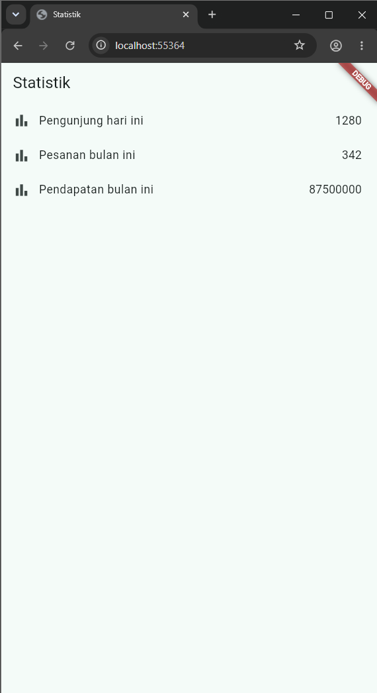

File `main.dart`
```dart
import 'package:flutter/material.dart';
import 'package:flutter_riverpod/flutter_riverpod.dart';

import 'pages/stats_page.dart';

/// ProviderScope menyediakan container Riverpod untuk seluruh aplikasi.
void main() {
  runApp(const ProviderScope(child: StatsApp()));
}

/// Root widget aplikasi contoh.
class StatsApp extends StatelessWidget {
  const StatsApp({super.key});

  @override
  Widget build(BuildContext context) {
    return MaterialApp(
      title: 'Statistik',
      theme: ThemeData(
        colorSchemeSeed: Colors.teal,
        useMaterial3: true,
      ),
      home: const StatsPage(),
    );
  }
}
```

File `stats_page.dart`
```dart
import 'package:flutter/material.dart';
import 'package:flutter_riverpod/flutter_riverpod.dart';

import '../providers/stats_provider.dart';

/// Halaman statistik yang mengonsumsi state dari [statsProvider].
class StatsPage extends ConsumerWidget {
  const StatsPage({super.key});

  @override
  Widget build(BuildContext context, WidgetRef ref) {
    // watch membuat UI dibangun ulang ketika state asynchronous berubah.
    final statsAsync = ref.watch(statsProvider);

    return Scaffold(
      appBar: AppBar(title: const Text('Statistik')),
      body: statsAsync.when(
        // Spinner ditampilkan selama notifier menunggu data.
        loading: () => const Center(child: CircularProgressIndicator()),
        // Error menampilkan pesan dan tombol untuk meminta data ulang.
        error: (error, _) => Center(
          child: Column(
            mainAxisSize: MainAxisSize.min,
            children: [
              Text('Gagal memuat statistik: $error'),
              const SizedBox(height: 12),
              FilledButton(
                // invalidate membuang state lama dan memanggil build lagi.
                onPressed: () => ref.invalidate(statsProvider),
                child: const Text('Coba lagi'),
              ),
            ],
          ),
        ),
        // Data sukses ditampilkan sebagai ListView berisi tiga item.
        data: (stats) => ListView.builder(
          itemCount: stats.length,
          itemBuilder: (context, index) {
            final statistic = stats[index];
            return ListTile(
              leading: const Icon(Icons.bar_chart),
              title: Text(statistic.label),
              trailing: Text(
                statistic.value.toString(),
                style: Theme.of(context).textTheme.titleMedium,
              ),
            );
          },
        ),
      ),
    );
  }
}
```

File `stats_provider.dart`
```dart
import 'dart:math';

import 'package:flutter_riverpod/flutter_riverpod.dart';

/// Model untuk satu statistik yang ditampilkan di dalam daftar.
class Statistic {
  const Statistic({required this.label, required this.value});

  /// Nama statistik, misalnya jumlah pengunjung.
  final String label;

  /// Nilai numerik statistik.
  final int value;
}

/// AsyncNotifier yang mensimulasikan pengambilan statistik dari server.
class StatsNotifier extends AsyncNotifier<List<Statistic>> {
  /// Dependency dibuat dapat diinjeksi agar unit test tidak acak dan cepat.
  StatsNotifier({Random? random, Duration? delay})
    : _random = random ?? Random(),
      _delay = delay ?? const Duration(seconds: 2);

  final Random _random;
  final Duration _delay;

  @override
  Future<List<Statistic>> build() async {
    // Delay dua detik mensimulasikan waktu tunggu permintaan network.
    await Future<void>.delayed(_delay);

    // Nilai acak di bawah 0.3 berarti request gagal (probabilitas 30%).
    if (_random.nextDouble() < 0.3) {
      throw Exception('Gagal mengambil data statistik.');
    }

    // Data sukses selalu terdiri dari tiga item statistik.
    return const [
      Statistic(label: 'Pengunjung hari ini', value: 1280),
      Statistic(label: 'Pesanan bulan ini', value: 342),
      Statistic(label: 'Pendapatan bulan ini', value: 87500000),
    ];
  }
}

/// Satu-satunya provider yang menyuplai state loading, error, atau data.
final statsProvider = AsyncNotifierProvider<StatsNotifier, List<Statistic>>(
  StatsNotifier.new,
  // Retry dilakukan eksplisit oleh tombol di UI, bukan otomatis berulang.
  retry: (retryCount, error) => null,
);

```

File `stats_provider_test.dart`
```dart
import 'dart:math';

import 'package:flutter_riverpod/flutter_riverpod.dart';
import 'package:flutter_test/flutter_test.dart';
import 'package:stats_prompt/providers/stats_provider.dart';

/// Random deterministik untuk memaksa cabang sukses atau gagal.
class FixedRandom implements Random {
  FixedRandom(this.value);

  final double value;

  @override
  bool nextBool() => value >= 0.5;

  @override
  double nextDouble() => value;

  @override
  int nextInt(int max) => (value * max).floor();
}

void main() {
  test('notifier mengembalikan tiga item saat request sukses', () async {
    // Override provider dengan delay nol dan random yang tidak gagal.
    final container = ProviderContainer(
      overrides: [
        statsProvider.overrideWith(
          () => StatsNotifier(random: FixedRandom(0.5), delay: Duration.zero),
        ),
      ],
    );
    addTearDown(container.dispose);

    // future selesai ketika AsyncNotifier menghasilkan data.
    final result = await container.read(statsProvider.future);

    expect(result, hasLength(3));
    expect(result.first.label, 'Pengunjung hari ini');
  });

  test('notifier menghasilkan error saat request gagal', () async {
    // Nilai 0.1 berada di bawah ambang kegagalan 0.3.
    final container = ProviderContainer(
      overrides: [
        statsProvider.overrideWith(
          () => StatsNotifier(random: FixedRandom(0.1), delay: Duration.zero),
        ),
      ],
    );
    addTearDown(container.dispose);

    // future harus melempar exception dari build notifier.
    await expectLater(
      container.read(statsProvider.future),
      throwsA(isA<Exception>()),
    );
  });
}
```

<p align="center">
  
  <br>
  <i>Output AI pertama</i>
</p>