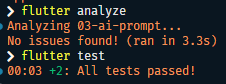

### AI Verification Checklist

Verifikasi implementasi AI pada folder [`03-ai-prompt/`](03-ai-prompt/):

| No. | Pemeriksaan                                                                   | Status |Keterangan                                                                                                                           |
| :-: | ----------------------------------------------------------------------------- | :----: | ------------------------------------------------------------------------------------------------------------------------------------ |
|  1  | Apakah state diubah secara immutable (tidak ada state.add() atau mutasi list langsung)?                                         | Lulus  | Tidak ada `state.add()` atau mutasi list langsung.                                                                                   |
|  2  | Apakah `ref.watch` hanya dipakai di dalam build, dan `ref.read` di callback? | Lulus  | `ref.watch` digunakan di `build`. Callback retry menggunakan `ref.invalidate(statsProvider)` untuk memuat ulang provider.            |
|  3  | Apakah ketiga state AsyncValue benar-benar ditangani (bukan hanya success)?                                     | Lulus  | State `loading`, `error`, dan `data` ditangani melalui `AsyncValue.when`.                                                            |
|  4  | Apakah provider dideklarasikan dengan tipe eksplisit dan tidak duplikat dengan provider lain?                   | Lulus  | Menggunakan satu `AsyncNotifierProvider<StatsNotifier, List<Statistic>>`.                                                            |
|  5  | Apakah kode AI memakai API Riverpod versi lama (`StateProvider` antipattern, `StateNotifierProvider` usang, atau `Consumer` bertingkat yang tidak perlu)? Perbaiki ke pola Notifier/ConsumerWidget.                                  | Lulus  | Menggunakan `AsyncNotifier`, `AsyncNotifierProvider`, dan `ConsumerWidget`, bukan `StateProvider` atau `StateNotifierProvider` lama. |
|  6  | Jalankan `flutter analyze` dan `flutter test`, apakah hasil AI lolos tanpa warning?                              | Lulus  | `flutter analyze` menghasilkan **No issues found** dan `flutter test` menghasilkan **All tests passed**.                              |

### Hasil Testing

  
   
  <i>Hasil testing AI</i>

