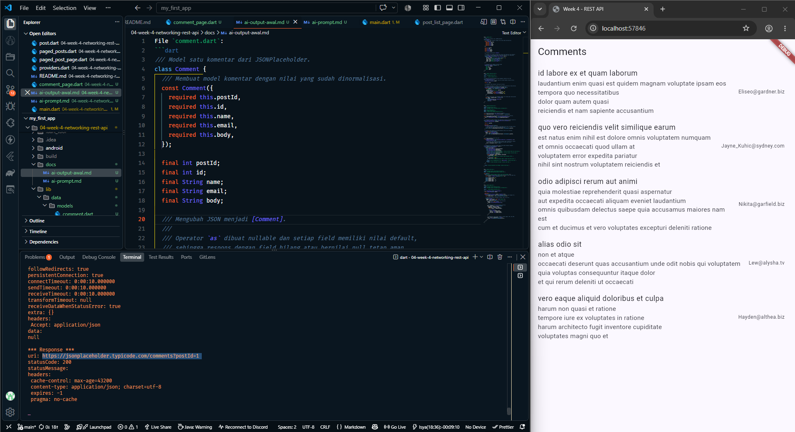
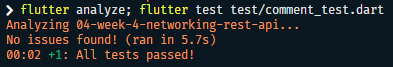

### AI Verification Checklist

1. **Apakah UI memanggil Dio secara langsung (dilarang) atau lewat repository?**
   - UI hanya memanggil `commentsProvider(1)`, sedangkan Dio dipakai lewat repository melalui provider. Dapat diverifikasi pada `lib/pages/comment_page.dart`.

2. **Apakah `fromJson` aman null, atau masih memakai cast langsung yang bisa crash?**
   - `fromJson` aman untuk null, karena field numerik memakai `(json[...] as num?)?.toInt() ?? 0`, sedangkan field teks memakai `as String? ?? ''`. Dapat diverifikasi pada `lib/data/models/comment.dart`

3. **Apakah `DioExceptionType` timeout, connection error, dan bad response dipetakan ke pesan pengguna?**
   - Ya, `DioExceptionType` timeout, `connectionError`, HTTP 404, dan HTTP 500 memiliki pesan khusus. Dapat diverifikasi pada `lib/data/comment_provider.dart`

4. **Apakah Base URL dan timeout terpusat di satu client?**
   - Base URL serta `connectTimeout`, `sendTimeout`, dan `receiveTimeout` 10 detik terpusat di `lib/data/api_client.dart`. Repository hanya menggunakan instance Dio tersebut.

5. **Apakah test menguji field yang hilang, bukan hanya happy path?**
   - Ya, test sudah menguji field yang hilang, bukan hanya happy path. Dapat diverifikasi pada test `Comment.fromJson mengisi default saat field hilang` di `test/comment_test.dart`.

6. **Apakah ditambahkan minimal satu edge case sendiri?**
   - Ya, ditambahkan edge case `Comment.fromJson aman saat semua field bernilai null` di `test/comment_test.dart`.

7. **Apakah `flutter analyze` dan `flutter test` selesai tanpa warning/error?**
   - `flutter analyze` sudah aman tanpa issue. `flutter test` untuk `test/comment_test.dart` juga aman.

**Contoh Tampilan:**

    
  <i>Contoh tampilan halaman komentar</i>

**Hasil Testing:**

    
  <i>Hasil uji coba halaman komentar</i>

