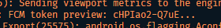
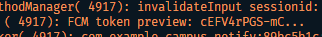

# Week 06 — Authentication, Security & Firebase Cloud Messaging

<p align="left">
  
  
  
  
  
  
</p>

> Dokumentasi praktikum Pemrograman Mobile — Minggu 6

| Informasi | Detail |
| --- | --- |
| **Nama** | Risky Adi Prasetya |
| **NIM** | 244107020153 |
| **Program Studi** | Teknik Informatika |
| **Kelas** | TI-3E |

## Daftar Isi

- [Tujuan Pembelajaran](#tujuan-pembelajaran)
- [Tech Stack](#tech-stack)
- [Konsep Autentikasi, Keamanan, dan FCM](#konsep-autentikasi-keamanan-dan-fcm)
- [Praktikum 1 — Login, Secure Storage, dan Token Refresh](#praktikum-1--login-secure-storage-dan-token-refresh)
- [Praktikum 2 — FCM, Permission, dan Token Lifecycle](#praktikum-2--fcm-permission-dan-token-lifecycle)
- [Praktikum 3 — Payload, App State, Deep Link, dan Topic](#praktikum-3--payload-app-state-deep-link-dan-topic)
- [AI Challenge](#ai-challenge)
- [Refactoring dan Testing](#refactoring-dan-testing)
- [Tugas dan Refleksi](#tugas-dan-refleksi)

---

## Tujuan Pembelajaran

Setelah menyelesaikan codelab ini, mahasiswa mampu:

- menjelaskan alur Firebase Auth, JWT, OAuth, Google Login, serta perbedaan ID token, access token, dan refresh token;
- menyimpan token secara aman dengan secure storage dan menerapkan token refresh otomatis;
- menjelaskan arsitektur FCM yang melibatkan app server, Firebase, dan perangkat;
- meminta notification permission serta mengelola lifecycle token melalui `getToken` dan `onTokenRefresh`;
- membedakan notification payload dan data payload pada state foreground, background, dan terminated;
- menangani klik notifikasi sebagai deep link dengan GoRouter dan menggunakan topic messaging;
- menerapkan prinsip keamanan dasar: tidak menyimpan secret di kode, tidak mengirim refresh token melalui URL, dan tidak mencetak token ke log.

## Tech Stack

| Komponen | Detail |
| --- | --- |
| Framework | Flutter & Dart |
| State management | flutter_riverpod |
| Routing | go_router |
| HTTP client | dio |
| Penyimpanan token | flutter_secure_storage (Keychain/Keystore) |
| Auth | Mock auth provider dengan JWT simulasi, siap dimigrasikan ke Firebase Auth |
| Push notification | firebase_core, firebase_messaging |
| Foreground notification | flutter_local_notifications |
| IDE | VS Code |
| Device | Smartphone fisik atau emulator Android dengan Google Play Services |
| Version Control | GitHub |

---

## Konsep Autentikasi, Keamanan, dan FCM

### Model Autentikasi

| Pola | Cara kerja singkat | Kapan dipakai |
| --- | --- | --- |
| Firebase Auth | SDK Firebase menukar kredensial menjadi ID token JWT yang diverifikasi backend | Login cepat tanpa membangun server auth sendiri |
| JWT + refresh token | Server menerbitkan access token berumur pendek dan refresh token berumur panjang | REST API milik sendiri |
| OAuth / Google Login | Aplikasi menerima authorization code dan menukarnya melalui provider | Login sosial atau SSO kampus |

Codelab ini menggunakan **mock auth provider dan JWT simulasi** agar berjalan tanpa backend. Pola repository dan refresh token tetap sama; saat migrasi ke Firebase Auth, sumber token yang diganti adalah implementasi repository.

### Access Token, Refresh Token, dan ID Token

- **ID token** adalah bukti identitas pengguna dan diverifikasi backend.
- **Access token** memberikan izin akses berumur pendek dan dikirim sebagai `Authorization: Bearer ...`.
- **Refresh token** digunakan untuk meminta access token baru tanpa login ulang dan hanya boleh disimpan di secure storage.

Alur yang digunakan:

```text
Login -> access (15 menit) + refresh (7 hari) tersimpan aman
Request API -- Bearer access --> 401 expired?
Ya -> tukar refresh -> access baru -> ulangi request satu kali
Refresh kedaluwarsa -> hapus sesi -> kembali ke /login
```

### Arsitektur FCM

```text
App Server -- kirim pesan --> Firebase Cloud Messaging -- push --> Perangkat
Aplikasi -- daftarkan registration token --> Backend per user
```

Alur wajibnya adalah meminta izin, mengambil registration token, mengirim token ke backend, dan memantau perubahan token. Backend kemudian mengirim pesan ke token perangkat atau topik.

### Notification Payload dan Data Payload

| Jenis | Isi | Perilaku |
| --- | --- | --- |
| `notification` | `title` dan `body` untuk manusia | Sistem menampilkan otomatis saat background/terminated; foreground perlu ditampilkan manual |
| `data` | Key-value bebas seperti `route` dan `id` | Diteruskan ke handler aplikasi dan tidak ditampilkan otomatis |

Gunakan gabungan `notification + data`: teks ditampilkan kepada pengguna, sedangkan `data.route` digunakan untuk deep link.

### Prinsip Keamanan

- Jangan simpan access token atau refresh token di `SharedPreferences`.
- Jangan hard-code secret atau credential backend di Dart.
- Jangan mencetak token penuh ke log atau screenshot.
- Kirim refresh token hanya di body `POST` melalui HTTPS, bukan query URL.
- Pesan personal memakai token perangkat; topic hanya untuk broadcast.

---

## Praktikum 1 — Login, Secure Storage, dan Token Refresh

### Membuat Project

```bash
flutter create campus_notify
cd campus_notify
flutter pub add flutter_riverpod go_router dio flutter_secure_storage
flutter pub add firebase_core firebase_messaging flutter_local_notifications
```

Struktur utama:

```text
lib/
├── main.dart
├── data/
│   ├── auth_repository.dart
│   ├── token_store.dart
│   ├── api_client.dart
│   └── api_errors.dart
├── providers/auth_provider.dart
├── messaging/push_service.dart
├── routes.dart
└── pages/
    ├── login_page.dart
    ├── home_page.dart
    └── announcement_page.dart
```

### 1. Token Store

File: `lib/data/token_store.dart`

Seluruh token hanya keluar-masuk melalui `flutter_secure_storage`:

```dart
import 'package:flutter_secure_storage/flutter_secure_storage.dart';

class TokenStore {
  TokenStore({FlutterSecureStorage? storage})
      : _storage = storage ?? const FlutterSecureStorage();

  final FlutterSecureStorage _storage;
  static const _accessKey = 'access_token';
  static const _refreshKey = 'refresh_token';

  Future<void> save({
    required String access,
    required String refresh,
  }) async {
    await _storage.write(key: _accessKey, value: access);
    await _storage.write(key: _refreshKey, value: refresh);
  }

  Future<String?> readAccess() => _storage.read(key: _accessKey);
  Future<String?> readRefresh() => _storage.read(key: _refreshKey);
  Future<void> clear() => _storage.deleteAll();
}
```

### 2. Repository Auth Mock

File: `lib/data/auth_repository.dart`

```dart
class AuthSession {
  const AuthSession({required this.access, required this.refresh});

  final String access;
  final String refresh;
}

class AuthRepository {
  // Titik ini dapat diganti FirebaseAuth.instance.signInWithEmailAndPassword
  // atau GoogleSignIn saat backend Firebase siap.
  Future<AuthSession> login({
    required String email,
    required String password,
  }) async {
    await Future<void>.delayed(const Duration(milliseconds: 500));
    if (!email.contains('@') || password.length < 6) {
      throw Exception('Email atau kata sandi tidak valid');
    }
    return AuthSession(
      access: 'mock-access-for-$email',
      refresh: 'mock-refresh-for-$email',
    );
  }

  Future<String> refresh(String refreshToken) async {
    await Future<void>.delayed(const Duration(milliseconds: 300));
    if (refreshToken.isEmpty) {
      throw Exception('Refresh token hilang');
    }
    return 'mock-access-renewed-${DateTime.now().millisecondsSinceEpoch}';
  }
}
```

### 3. Dio dengan Refresh Otomatis

File: `lib/data/api_client.dart`

Interceptor menambahkan access token, menyegarkan token saat menerima 401, lalu mengulang request satu kali. Implementasi nyata harus menambahkan penanda retry pada `RequestOptions` agar request yang sama tidak mengalami loop refresh.

```dart
import 'package:dio/dio.dart';

import 'auth_repository.dart';
import 'token_store.dart';

Dio buildApiClient(TokenStore store, AuthRepository auth) {
  final dio = Dio(
    BaseOptions(baseUrl: 'https://example-campus-api.test'),
  );

  dio.interceptors.add(
    InterceptorsWrapper(
      onRequest: (options, handler) async {
        final access = await store.readAccess();
        if (access != null) {
          options.headers['Authorization'] = 'Bearer $access';
        }
        handler.next(options);
      },
      onError: (error, handler) async {
        final alreadyRetried =
            error.requestOptions.extra['retried'] == true;
        if (error.response?.statusCode != 401 || alreadyRetried) {
          handler.next(error);
          return;
        }

        final refresh = await store.readRefresh();
        if (refresh == null) {
          handler.next(error);
          return;
        }

        try {
          final renewed = await auth.refresh(refresh);
          await store.save(access: renewed, refresh: refresh);
          final request = error.requestOptions;
          request.extra['retried'] = true;
          request.headers['Authorization'] = 'Bearer $renewed';
          handler.resolve(await dio.fetch(request));
        } catch (_) {
          await store.clear();
          handler.next(error);
        }
      },
    ),
  );
  return dio;
}
```

### 4. Provider Auth dan Guard Route

`AuthNotifier` membaca access token saat startup, menyimpan sesi setelah login, dan menghapus sesi saat logout. GoRouter mengarahkan pengguna yang belum login ke `/login`.

```dart
final authStateProvider =
    AsyncNotifierProvider<AuthNotifier, bool>(AuthNotifier.new);

class AuthNotifier extends AsyncNotifier<bool> {
  @override
  Future<bool> build() async {
    final token = await ref.watch(tokenStoreProvider).readAccess();
    return token != null;
  }

  Future<void> login(String email, String password) async {
    state = const AsyncLoading();
    state = await AsyncValue.guard(() async {
      final session = await ref.read(authRepositoryProvider).login(
            email: email,
            password: password,
          );
      await ref.read(tokenStoreProvider).save(
            access: session.access,
            refresh: session.refresh,
          );
      return true;
    });
  }

  Future<void> logout() async {
    await ref.read(tokenStoreProvider).clear();
    ref.invalidateSelf();
  }
}
```
<p align="center">
  <video src="screenshots/login-1.mp4" controls width="50%" muted autoplay loop></video>
  <br>
  <i>Video: login mock dan token refresh otomatis</i>
</p>

---

## Praktikum 2 — FCM, Permission, dan Token Lifecycle

### 1. Registrasi Firebase

1. Buat project di [Firebase Console](https://console.firebase.google.com/).
2. Tambahkan aplikasi Android dengan `applicationId` yang sesuai.
3. Unduh `google-services.json` ke `android/app/`. Untuk iOS, tambahkan `GoogleService-Info.plist`.
4. Ikuti konfigurasi plugin Google Services dan FCM Flutter client.
5. Panggil `Firebase.initializeApp()` sebelum `runApp`.

### 2. Permission dan Local Notification

File: `lib/messaging/push_service.dart`

```dart
import 'package:firebase_messaging/firebase_messaging.dart';
import 'package:flutter_local_notifications/flutter_local_notifications.dart';

final localNotifications = FlutterLocalNotificationsPlugin();
String? pendingDeepLink;

Future<bool> requestNotificationPermission() async {
  final settings = await FirebaseMessaging.instance.requestPermission(
    alert: true,
    badge: true,
    sound: true,
  );
  return settings.authorizationStatus == AuthorizationStatus.authorized ||
      settings.authorizationStatus == AuthorizationStatus.provisional;
}

Future<void> initLocalNotifications() async {
  const android = AndroidInitializationSettings('@mipmap/ic_launcher');
  const ios = DarwinInitializationSettings();
  await localNotifications.initialize(
    const InitializationSettings(android: android, iOS: ios),
    onDidReceiveNotificationResponse: (response) {
      pendingDeepLink = response.payload;
    },
  );
}
```

### 3. `getToken`, `onTokenRefresh`, dan Topic

```dart
Future<void> initFcmToken({
  required Future<void> Function(String token) onToken,
}) async {
  final token = await FirebaseMessaging.instance.getToken();
  if (token != null) {
    await onToken(token);
  }

  FirebaseMessaging.instance.onTokenRefresh.listen(onToken);
  await FirebaseMessaging.instance.subscribeToTopic('pengumuman-kampus');
}
```

```dart
Future<void> login(String email, String password) async {
    state = const AsyncLoading();
    state = await AsyncValue.guard(() async {
      final session = await ref
          .read(authRepositoryProvider)
          .login(email: email, password: password);
      await ref
          .read(tokenStoreProvider)
          .save(access: session.access, refresh: session.refresh);
      await requestNotificationPermission();
      await initFcmToken(
        onToken: (token) async {
          final preview = token.length > 12
              ? '${token.substring(0, 12)}...'
              : 'token tersedia';
          debugPrint('FCM token preview: $preview');
        },
      );
      return true;
    });
  }

```

<p align="center">
  </img>
  <br>
  <i>FCM Token pertama</i>
</p>
<p align="center">
  </img>
  <br>
  <i>FCM Token kedua setelah reinstall</i>
</p>

### 4. Pengujian dari Firebase Console

Kirim campaign dengan `title` dan `body` ke aplikasi Android saat aplikasi berada di background. Banner sistem harus muncul dan klik banner harus membuka aplikasi. Simpan bukti sebagai `screenshots/fcm-console-test.png`.

<p align="center">
  <video src="screenshots/fcm-console-test.mp4" controls width="75%" muted autoplay loop></video>
  <br>
  <i>Pengujian FCM dari Firebase Console</i>
</p>

---

## Praktikum 3 — Payload, App State, Deep Link, dan Topic

### 1. Background Handler

```dart
@pragma('vm:entry-point')
Future<void> firebaseMessagingBackgroundHandler(
  RemoteMessage message,
) async {
  // Catat atau simpan data ringan saja. Navigasi dilakukan saat klik.
}

void registerBackgroundHandler() {
  FirebaseMessaging.onBackgroundMessage(
    firebaseMessagingBackgroundHandler,
  );
}
```

### 2. Payload Gabungan dan Tiga Handler

Contoh payload HTTP v1:

```json
{
  "message": {
    "topic": "pengumuman-kampus",
    "notification": {
      "title": "Jadwal kuliah berubah",
      "body": "Kelas Mobile pindah ke Ruang A2 jam 13.00"
    },
    "data": {
      "route": "/pengumuman/3",
      "id": "3"
    }
  }
}
```

```dart
void listenForeground(void Function(String route) go) {
  FirebaseMessaging.onMessage.listen((message) async {
    final route = routeFromMessage(message.data);
    const details = AndroidNotificationDetails(
      'pengumuman',
      'Pengumuman Kampus',
      importance: Importance.high,
      priority: Priority.high,
    );
    await localNotifications.show(
      message.hashCode,
      message.notification?.title ?? 'Pengumuman',
      message.notification?.body ?? '',
      const NotificationDetails(android: details),
      payload: route,
    );
  });

  FirebaseMessaging.onMessageOpenedApp.listen((message) {
    go(routeFromMessage(message.data));
  });
}

Future<void> handleTerminated(void Function(String route) go) async {
  final initial = await FirebaseMessaging.instance.getInitialMessage();
  if (initial != null) {
    go(routeFromMessage(initial.data));
  }
  if (pendingDeepLink != null) {
    go(pendingDeepLink!);
  }
}
```

### 3. Matriks Pengujian Wajib

| State | Hasil yang diharapkan | Cara uji | Hasil |
| --- | --- | --- | --- |
| Foreground | Local notification muncul dan klik masuk `/pengumuman/3` | Aplikasi terbuka, kirim dari console/backend | Berhasil |
| Background | Banner sistem muncul dan klik masuk ke rute benar | Tekan Home, kirim, klik banner | Berhasil |
| Terminated | Aplikasi terbuka ke rute benar melalui `getInitialMessage` | Swipe-close aplikasi, kirim, klik banner | Berhasil |

<p align="center">
  <video src="screenshots/Foreground.mp4" controls width="75%" muted autoplay loop></video>
  <br>
  <i>Hasil Foreground</i>
</p>
<p align="center">
  <video src="screenshots/Background.mp4" controls width="75%" muted autoplay loop></video>
  <br>
  <i>Hasil Background</i>
</p>
<p align="center">
  <video src="screenshots/Terminated.mp4" controls width="75%" muted autoplay loop></video>
  <br>
  <i>Hasil Terminated</i>
</p>

### 4. Topic Messaging

```dart
await FirebaseMessaging.instance.subscribeToTopic('pengumuman-kampus');
await FirebaseMessaging.instance.unsubscribeFromTopic('pengumuman-kampus');
```
---

## AI Challenge
### AI Prompt Challenge

```text
Aplikasi Flutter Campus Notification App.
Stack: firebase_messaging, flutter_local_notifications,
flutter_secure_storage, go_router, Riverpod.
Buatkan PushService dengan:
- requestPermission + getToken + onTokenRefresh (kirim ke POST /devices)
- onMessage (tampilkan local notification manual)
- onMessageOpenedApp + getInitialMessage (navigasi ke data.route)
- subscribe/unsubscribe topic pengumuman-kampus
- background handler top-level dengan @pragma('vm:entry-point')
Tandai bagian yang BERBEDA untuk Android 13+ vs iOS,
dan bagian yang tidak boleh mengakses BuildContext.
```

### AI Verification Checklist

- [ ] Background handler adalah fungsi top-level dengan `@pragma('vm:entry-point')`.
- [ ] `onTokenRefresh` mengirim token baru ke backend, bukan hanya mencetaknya.
- [ ] Foreground memakai local notification manual.
- [ ] Klik dari foreground, background, dan terminated masuk ke rute yang benar.
- [ ] Token atau secret tidak di-hard-code dan token penuh tidak di-log.
- [ ] Perbaikan manual dan alasan teknis dicatat.

### Dokumentasi AI

Simpan artefak AI di folder `docs/`:

| Dokumen | Lokasi | Status |
| --- | --- | --- |
| Prompt yang digunakan | `docs/ai-prompt.md` | Isi setelah AI Challenge |
| Output awal AI | `docs/ai-output-awal.md` | Isi setelah AI Challenge |
| Daftar perbaikan manual | `docs/ai-manual-fixes.md` | Isi setelah verifikasi |
| Hasil uji tiga app state | `docs/fcm-state-testing.md` | Isi setelah pengujian |
| Keputusan final dan alasan teknis | `docs/ai-decision.md` | Isi setelah verifikasi |

---

## Refactoring dan Testing

### Refactoring Challenge

1. Pindahkan semua string rute (`/login`, `/`, dan `/pengumuman/:id`) ke `lib/routes.dart`.
2. Ekstrak parsing `RemoteMessage.data` ke fungsi murni `routeFromMessage(Map<String, dynamic> data)`.
3. Pindahkan pemetaan `DioException` untuk status 401, timeout, dan offline ke `lib/data/api_errors.dart`.
4. Pastikan UI menerima pesan ramah pengguna, bukan exception mentah atau token.

Contoh fungsi route yang dapat diuji tanpa Firebase:

```dart
String routeFromMessage(Map<String, dynamic> data) {
  final route = data['route'] as String? ?? '/';
  return route.startsWith('/') ? route : '/$route';
}
```

### Testing: Unit Test Tanpa Firebase Sungguhan

Buat `test/auth_push_test.dart` dan uji setidaknya:

```dart
import 'package:flutter_test/flutter_test.dart';

void main() {
  test('routeFromMessage menangani route kosong dan tanpa slash', () {
    expect(routeFromMessage({}), '/');
    expect(
      routeFromMessage({'route': 'pengumuman/3'}),
      '/pengumuman/3',
    );
    expect(
      routeFromMessage({'route': '/pengumuman/3'}),
      '/pengumuman/3',
    );
  });

  test('data payload membawa id pengumuman', () {
    const data = {'route': '/pengumuman/3', 'id': '3'};
    expect(data['id'], '3');
    expect(routeFromMessage(data), '/pengumuman/3');
  });

  test('status login mengikuti access token', () {
    String? access = 'mock-access';
    expect(access != null, isTrue);
    access = null;
    expect(access != null, isFalse);
  });

  test('refresh gagal mengharuskan login ulang', () {
    const refresh = '';
    expect(refresh.isEmpty, isTrue);
  });
}
```

Jalankan verifikasi:

```bash
flutter analyze
flutter test
```

### Hasil Testing

| Perintah | Hasil |
| --- | --- |
| `flutter analyze` | Lulus / Gagal |
| `flutter test` | Lulus / Gagal |
| Uji foreground | Lulus / Gagal |
| Uji background | Lulus / Gagal |
| Uji terminated | Lulus / Gagal |

## Tugas dan Refleksi

### Mini Project / Industry Challenge

Bangun **Campus Notification App** sebagai tugas minggu ini:

1. Implementasikan login mock atau Firebase Auth dengan guard route.
2. Simpan token di secure storage dan refresh otomatis sekali saat 401.
3. Integrasikan permission, `getToken`, `onTokenRefresh`, dan dokumentasikan endpoint `POST /devices`.
4. Kirim payload gabungan `notification + data` dan buktikan deep link pada tiga app state.
5. Sertakan screenshot token terpotong, banner, dan halaman tujuan di `screenshots/`.
6. Sertakan minimal dua unit test yang lulus.
7. Dokumentasikan prompt AI, output awal, perbaikan manual, dan hasil pengujian di `docs/`.
8. Push ke repository portfolio pada folder `06-week-6-authentication-security-fcm/` dengan struktur `lib/`, `test/`, `docs/`, `README.md`, dan `screenshots/`.

### Refleksi

Tuliskan jawaban Anda sendiri:

1. Mengapa refresh token tidak boleh disimpan di `SharedPreferences`? Apa risikonya bila bocor?

   **Jawaban:**

2. Apa yang rusak bila `onTokenRefresh` diabaikan selama satu semester?

   **Jawaban:**

3. Kapan memakai topic dan kapan memakai token perangkat? Berikan contoh pesan kampus untuk masing-masing.

   **Jawaban:**

4. Bagian mana dari draf AI yang ditolak atau diperbaiki, dan mengapa?

   **Jawaban:**

---
