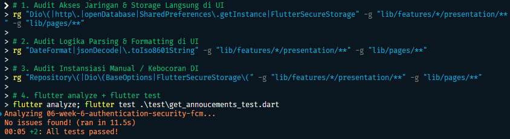

# Week 07 — Clean Architecture Feature-First

<p align="left">
  
  
  
  
  
</p>

> Dokumentasi praktikum Pemrograman Mobile — refactor project Minggu 6

| Informasi | Detail |
| --- | --- |
| **Nama** | Risky Adi Prasetya |
| **NIM** | 244107020153 |
| **Program Studi** | Teknik Informatika |
| **Kelas** | TI-3E |
| **Project** | `campus_notify` |

## Daftar Isi

- [Tujuan Pembelajaran](#tujuan-pembelajaran)
- [Kondisi Project Minggu 6](#kondisi-project-minggu-6)
- [Konsep SOLID dan Clean Architecture](#konsep-solid-dan-clean-architecture)
- [Struktur Target Feature-First](#struktur-target-feature-first)
- [Praktikum 1 — Audit Layer](#praktikum-1--audit-layer)
- [Praktikum 2 — Domain dan Data](#praktikum-2--domain-dan-data)
- [Praktikum 3 — Presentation, DI, dan Verifikasi](#praktikum-3--presentation-di-dan-verifikasi)
- [AI Challenge](#ai-challenge)
- [Refactoring, Testing, dan Error Umum](#refactoring-testing-dan-error-umum)
- [Checklist Penyelesaian](#checklist-penyelesaian)
- [Tugas dan Refleksi](#tugas-dan-refleksi)

---

## Tujuan Pembelajaran

- menjelaskan prinsip SOLID dan *separation of concerns* dengan contoh kode Flutter;
- membedakan struktur *feature-first* dan *layer-first* beserta trade-off-nya;
- menjelaskan layer presentation, domain, dan data serta aturan dependensi yang mengarah ke dalam;
- membedakan entity dan model serta menjelaskan peran repository, use case, dan dependency injection;
- merefactor project Minggu 5/6 menjadi struktur *feature-first* dengan layer yang terpisah;
- menguji use case dengan repository palsu tanpa database, Firebase, atau jaringan sungguhan.

---

## Kondisi Project Minggu 6

Project yang direfactor adalah aplikasi `campus_notify` dari
[README Minggu 6](README.md). Fitur yang sudah tersedia adalah login dengan
token simulasi, secure storage, routing GoRouter, pengumuman, dan Firebase
Cloud Messaging.

Struktur awal yang digunakan:

```text
lib/
├── main.dart
├── data/
│   ├── api_client.dart
│   ├── api_errors.dart
│   ├── auth_repository.dart
│   └── token_store.dart
├── messaging/
│   └── push_service.dart
├── pages/
│   ├── announcement_page.dart
│   ├── home_page.dart
│   └── login_page.dart
├── providers/
│   └── auth_provider.dart
└── routes.dart
```

Struktur tersebut termasuk *layer-first* karena kode dikelompokkan
berdasarkan jenis teknologinya. Untuk project yang memiliki auth,
announcements, dan messaging, struktur ini mulai menyulitkan karena satu
fitur tersebar di banyak folder.

Sebelum refactor, buat snapshot:

```bash
git add .
git commit -m "chore: snapshot before clean architecture"
```
---

## Konsep SOLID dan Clean Architecture

### SOLID dalam satu contoh Flutter

| Prinsip | Arti praktis | Gejala pelanggaran di Flutter |
| --- | --- | --- |
| **S — Single Responsibility** | Satu kelas punya satu alasan berubah | Widget 400 baris sekaligus fetch API, parsing JSON, dan formatting tanggal |
| **O — Open/Closed** | Tambah perilaku lewat ekstensi, bukan mengedit kode lama | Sumber data baru memaksa edit widget yang sudah berjalan |
| **L — Liskov Substitution** | Pengganti harus dapat menggantikan implementasi asli tanpa merusak perilaku | Repository palsu untuk test melempar error yang tidak pernah dilempar repository asli |
| **I — Interface Segregation** | Klien tidak dipaksa bergantung pada API yang tidak dipakai | Satu `AppRepository` besar untuk auth, announcements, dan push |
| **D — Dependency Inversion** | Kode bergantung pada abstraksi, bukan concrete implementation | Notifier memanggil `Dio` atau SQLite langsung alih-alih repository |

### Tiga layer dan aturan dependensi

```text
presentation (widget, notifier, router)
      |
      v
domain (entity, repository interface, use case, failure)
      ^
      |
data (model, repository implementation, Dio, secure storage, Firebase)
```

Aturan emas (*dependency rule*) adalah dependensi hanya mengarah ke dalam:

- `presentation` boleh memakai `domain`;
- `data` mengimplementasikan kontrak `domain`;
- `domain` tidak mengenal Flutter, Dio, SQLite, Firebase, atau secure storage;
- `data` tidak boleh mengimpor widget/presentation;
- komunikasi antarfitur dilakukan melalui kontrak domain atau rute, bukan
  mengimpor widget fitur lain.

Dengan aturan ini, logika bisnis dapat diuji sebagai Dart murni.

### Feature-first vs layer-first

| Struktur | Bentuk | Kapan dipakai | Trade-off |
| --- | --- | --- | --- |
| **Feature-first** | `lib/features/announcements/{data,domain,presentation}` | Project multi-fitur | Satu fitur mudah dipahami, diuji, dan dihapus; perlu disiplin menjaga batas |
| **Layer-first** | `lib/{data,domain,presentation}` | Project kecil satu fitur | Cepat dibuat, tetapi fitur bertambah akan tersebar dan folder menjadi sulit dipelihara |

### Kosakata arsitektur

- **Entity** adalah objek bisnis murni tanpa `toMap`, `fromMap`, atau `toJson`;
  entity hidup di `domain`.
- **Model** adalah representasi JSON/SQLite/Firebase dan mapping-nya ke entity;
  model hidup di `data`.
- **Repository interface** adalah kontrak yang dibutuhkan domain.
- **Repository implementation** memenuhi kontrak menggunakan Dio, secure
  storage, SQLite, atau Firebase.
- **Use case** mewakili satu operasi bisnis dan dipanggil presentation.
- **DI** menyuntikkan implementasi melalui provider Riverpod; widget tidak
  pernah membuat repository dengan `new`.

Memindahkan file saja belum menjadi Clean Architecture. Yang dinilai adalah
arah dependensi: widget tidak boleh memanggil Dio, dan notifier tidak boleh
memanggil SQLite atau Firebase secara langsung.

---

## Struktur Target Feature-First

Refactor project Minggu 6 dengan struktur berikut. Nama file lama boleh
dipertahankan bila masih sesuai tanggung jawabnya, tetapi kontrak dan
implementasinya harus dipisah.

```text
lib/
├── core/
│   ├── failures.dart
│   ├── format.dart
│   └── providers.dart
├── features/
│   ├── auth/
│   │   ├── domain/
│   │   │   ├── entities/auth_session.dart
│   │   │   ├── repositories/auth_repository.dart
│   │   │   └── usecases/login.dart
│   │   ├── data/
│   │   │   ├── models/auth_session_model.dart
│   │   │   └── repositories/auth_repository_impl.dart
│   │   └── presentation/
│   │       ├── providers/auth_providers.dart
│   │       └── pages/login_page.dart
│   └── announcements/
│       ├── domain/
│       │   ├── entities/announcement.dart
│       │   ├── repositories/announcement_repository.dart
│       │   └── usecases/get_announcements.dart
│       ├── data/
│       │   ├── models/announcement_model.dart
│       │   └── repositories/announcement_repository_impl.dart
│       └── presentation/
│           ├── providers/announcement_providers.dart
│           └── pages/
│               ├── announcement_page.dart
│               └── home_page.dart
├── messaging/
│   └── push_service.dart
├── main.dart
└── routes.dart
```

`push_service.dart` tetap dapat menjadi service lintas fitur karena FCM bukan
entity pengumuman. Namun service tersebut harus dipanggil melalui wiring atau
provider, bukan dibuat dari halaman.

---

## Praktikum 1 — Audit Layer

### 1. Pemetaan file lama

| File lama | Layer saat ini | Tujuan setelah refactor | Masalah yang diaudit |
| --- | --- | --- | --- |
| `lib/pages/login_page.dart` | Presentation | `features/auth/presentation/pages/login_page.dart` | Pastikan tidak memanggil `Dio` atau secure storage |
| `lib/pages/home_page.dart` | Presentation | `features/announcements/presentation/pages/home_page.dart` | Pastikan hanya membaca state |
| `lib/pages/announcement_page.dart` | Presentation | `features/announcements/presentation/pages/announcement_page.dart` | Parsing data dipindah ke data/domain |
| `lib/providers/auth_provider.dart` | Presentation/state | `features/auth/presentation/providers/auth_providers.dart` | State tidak boleh membuat concrete repository |
| `lib/data/auth_repository.dart` | Data + kontrak tercampur | Kontrak di domain, impl di data | Interface dan implementasi masih satu file |
| `lib/data/api_client.dart` | Data | `auth/data` atau core infrastructure | Hanya data layer yang boleh memakainya |
| `lib/data/token_store.dart` | Data | `auth/data` | Tidak boleh diakses widget langsung |
| `lib/data/api_errors.dart` | Data | Mapping ke `core/failures.dart` | Exception mentah tidak boleh mencapai UI |
| `lib/messaging/push_service.dart` | Infrastructure | Tetap service data/infrastructure | Background handler tidak boleh memakai state UI |
| `lib/routes.dart` | Presentation/infrastructure | Tetap di root | Hanya berisi rute dan parsing rute murni |

### 2. Tiga pencarian pelanggaran

Jalankan dari folder `06-week-6-authentication-security-fcm`:

```bash
# Widget yang menyentuh jaringan, database, atau storage langsung
rg "Dio\(|http\.|openDatabase|SharedPreferences\.getInstance|FlutterSecureStorage" lib/pages lib/widgets lib/features

# Logika bisnis atau mapping mentah di widget
rg "DateFormat|jsonDecode|\.toIso8601String" lib/pages lib/widgets lib/features

# Instansiasi manual yang membocorkan DI
rg "Repository\(|Dio\(BaseOptions|FlutterSecureStorage\(" lib/pages lib/providers lib/features
```

Setiap temuan menjadi satu item refactor. Target akhirnya adalah tidak ada
hasil di folder `presentation`.

---

## Praktikum 2 — Domain dan Data

### 1. Entity murni

Contoh entity pengumuman di
`lib/features/announcements/domain/entities/announcement.dart`:

```dart
class Announcement {
  const Announcement({
    this.id,
    required this.title,
    this.body = '',
    required this.publishedAt,
  });

  final int? id;
  final String title;
  final String body;
  final DateTime publishedAt;
}
```

Entity tidak mengimpor Flutter, Dio, Firebase, atau package storage.

### 2. Failure dan repository interface

`lib/core/failures.dart` berisi kegagalan yang dapat dipahami domain:

```dart
sealed class Failure {
  const Failure(this.message);
  final String message;
}

class LocalFailure extends Failure {
  const LocalFailure(super.message);
}

class NetworkFailure extends Failure {
  const NetworkFailure(super.message);
}

class AuthFailure extends Failure {
  const AuthFailure(super.message);
}
```

Kontrak `lib/features/announcements/domain/repositories/announcement_repository.dart`:

```dart
import '../../../../core/failures.dart';
import '../entities/announcement.dart';

abstract class AnnouncementRepository {
  Future<({List<Announcement> items, Failure? failure})>
      fetchAnnouncements();
}
```

Kontrak berada di domain karena domain menentukan kebutuhan bisnis, bukan
detail cara mengambil data. Implementasi data bebas memakai Dio atau sumber
lain selama kontrak tetap terpenuhi.

### 3. Model dan repository implementation

Mapping JSON hanya berada di
`lib/features/announcements/data/models/announcement_model.dart`:

```dart
import '../../domain/entities/announcement.dart';

class AnnouncementModel extends Announcement {
  const AnnouncementModel({
    super.id,
    required super.title,
    super.body = '',
    required super.publishedAt,
  });

  factory AnnouncementModel.fromJson(Map<String, Object?> json) {
    return AnnouncementModel(
      id: (json['id'] as num?)?.toInt(),
      title: json['title'] as String? ?? '',
      body: json['body'] as String? ?? '',
      publishedAt: DateTime.tryParse(
            json['published_at'] as String? ?? '',
          ) ??
          DateTime.fromMillisecondsSinceEpoch(0),
    );
  }

  Announcement toEntity() => Announcement(
        id: id,
        title: title,
        body: body,
        publishedAt: publishedAt,
      );
}
```

`announcement_repository_impl.dart` menangkap exception teknis, melakukan
mapping model ke entity, lalu mengembalikan `Failure`:

```dart
class AnnouncementRepositoryImpl implements AnnouncementRepository {
  const AnnouncementRepositoryImpl({required this.fetchJson});

  final Future<List<Map<String, Object?>>> Function() fetchJson;

  @override
  Future<({List<Announcement> items, Failure? failure})>
      fetchAnnouncements() async {
    try {
      final rows = await fetchJson();
      final items = rows
          .map((row) => AnnouncementModel.fromJson(row).toEntity())
          .toList();
      return (items: items, failure: null);
    } catch (error) {
      return (
        items: const <Announcement>[],
        failure: NetworkFailure('Gagal memuat pengumuman: $error'),
      );
    }
  }
}
```

Pada implementasi nyata, `fetchJson` dapat dibungkus oleh `ApiClient`.
Exception Dio, Firebase, dan secure storage tidak boleh bocor ke presentation.

### 4. Use case

`lib/features/announcements/domain/usecases/get_announcements.dart`:

```dart
import '../../../../core/failures.dart';
import '../entities/announcement.dart';
import '../repositories/announcement_repository.dart';

class GetAnnouncements {
  const GetAnnouncements(this._repository);

  final AnnouncementRepository _repository;

  Future<({List<Announcement> items, Failure? failure})> call() {
    return _repository.fetchAnnouncements();
  }
}
```

Use case wajib ketika operasi memiliki validasi, sorting, gabungan beberapa
repository, refresh token, atau sinkronisasi. CRUD satu baris boleh langsung
dari repository ke notifier jika belum memiliki aturan bisnis; keputusan ini
harus didokumentasikan agar tidak menjadi over-engineering.

---

## Praktikum 3 — Presentation, DI, dan Verifikasi

### 1. Dependency injection dengan Riverpod

Semua wiring berada di
`lib/features/announcements/presentation/providers/announcement_providers.dart`:

```dart
final announcementRepositoryProvider =
    Provider<AnnouncementRepository>((ref) {
  return AnnouncementRepositoryImpl(
    fetchJson: () => ref.watch(apiClientProvider).getAnnouncements(),
  );
});

final getAnnouncementsProvider = Provider<GetAnnouncements>((ref) {
  return GetAnnouncements(ref.watch(announcementRepositoryProvider));
});

final announcementsProvider =
    FutureProvider<List<Announcement>>((ref) async {
  final result = await ref.watch(getAnnouncementsProvider).call();
  if (result.failure != null) {
    throw Exception(result.failure!.message);
  }
  return result.items;
});
```

Provider `apiClientProvider` dapat ditempatkan di `core/providers.dart`.
Saat test, provider tersebut dapat dioverride dengan fake. Widget tidak
pernah menulis `AnnouncementRepositoryImpl()` atau `Dio()`.

### 2. Halaman hanya membaca state

Halaman pengumuman cukup membaca `announcementsProvider`:

```dart
class AnnouncementPage extends ConsumerWidget {
  const AnnouncementPage({super.key});

  @override
  Widget build(BuildContext context, WidgetRef ref) {
    final state = ref.watch(announcementsProvider);
    return state.when(
      loading: () => const Center(child: CircularProgressIndicator()),
      error: (error, _) => ErrorView(
        message: '$error',
        onRetry: () => ref.invalidate(announcementsProvider),
      ),
      data: (items) => items.isEmpty
          ? const Center(child: Text('Belum ada pengumuman.'))
          : AnnouncementList(items),
    );
  }
}
```

Halaman tidak mengandung SQL, Dio, JSON, secure storage, atau formatting
tanggal mentah.

### 3. Formatting dan parsing rute

Ekstrak fungsi murni ke `lib/core/format.dart` dan `lib/routes.dart`:

```dart
String formatDate(DateTime value) {
  return '${value.day.toString().padLeft(2, '0')}/'
      '${value.month.toString().padLeft(2, '0')}/${value.year}';
}

String? routeFromMessage(Map<String, dynamic> data) {
  final route = data['route'];
  return route is String && route.startsWith('/pengumuman/')
      ? route
      : null;
}
```

Fungsi tersebut dapat diuji tanpa `BuildContext` atau device.

### 4. Verifikasi dependency rule

Semua perintah berikut harus menghasilkan nol hasil pada dua grep pertama:

```bash
# Presentation steril dari data mentah
rg "Dio\(|openDatabase|getDatabasesPath|FlutterSecureStorage|SharedPreferences\.getInstance|jsonDecode" lib/features/*/presentation lib/pages

# Domain steril dari framework dan package
rg "import 'package:flutter|import 'package:dio|import 'package:sqflite|import 'package:firebase" lib/features/*/domain lib/core

# Static analysis dan seluruh test
flutter analyze
flutter test
```

Definisi selesai: aplikasi berjalan sama seperti sebelum refactor, hasil grep
bersih, `flutter analyze` bersih, test hijau, dan screenshot before/after
tersimpan di `screenshots/`.

---

## AI Challenge

### Prompt

Gunakan prompt berikut pada coding assistant:

```text
Project Flutter saya: campus_notify (auth + FCM + daftar pengumuman).
Kondisi kini: folder lib/{data, providers, pages, messaging},
repository tercampur dengan implementasi, widget memanggil Dio langsung.
Tugas:
1. Usulkan struktur feature-first Clean Architecture
   (presentation/domain/data) untuk fitur auth + announcements.
2. Untuk tiap file lama, sebutkan tujuan barunya (pindah/pecah/hapus).
3. Tandai bagian yang over-engineering bila diterapkan ke CRUD sederhana,
   dan kapan use case benar-benar dibutuhkan vs repository langsung.
4. Tunjukkan wiring DI dengan Riverpod (tanpa package DI tambahan).
Jelaskan trade-off setiap keputusan.
```

### AI Verification Checklist
- Apakah interface repository tinggal di domain dan implementasi di data? (tolak bila AI menaruh keduanya di satu folder).

  - **Jawaban:** Ya, Interface `auth_repository.dart` ditempatkan di `features/auth/domain/repositories/`, sedangkan implementasinya `auth_repository_impl.dart` dipisah ke `features/auth/data/repositories/`

- Apakah domain bebas import Flutter/Dio/SQLite/Firebase? Periksa dengan grep, bukan dengan membaca sekilas.

  - **Jawaban:** Ya, Seluruh berkas di dalam layer domain hanya berisi logika Dart murni tanpa ada import ke paket eksternal (Flutter SDK, Dio, SQLite, atau Firebase).

- Apakah AI membuat use case untuk tiap CRUD satu-baris? (itu over-engineering: cukup repository langsung ke notifier, dengan alasan tertulis).

  - **Jawaban:** Tidak, AI secara spesifik membatasi penggunaan use case hanya untuk alur dengan logika bisnis (seperti Login dan RefreshSession). Untuk CRUD sederhana satu baris, komunikasi langsung diarahkan dari Notifier/Provider ke Repository untuk menghindari over-engineering.

- Apakah entity bebas mapping (toMap/fromMap/toJson hanya di model)?

  - **Jawaban:** Ya, objek Entity pada layer domain berupa kelas Dart murni. Fungsi serialisasi (fromJson/toJson) hanya ada pada file Model di layer data.

- Apakah wiring DI terpusat di provider dan widget tidak new Repository() sendiri?

  - **Jawaban:** Ya, seluruh instantiation dan wiring menggunakan Riverpod Provider. Layer presentation (widget) hanya mengonsumsi data melalui `ref.watch/ref`.read tanpa melakukan instansiasi langsung terhadap `Repository` atau `Service`.

- Keputusan final dan alasan teknis Anda, boleh berbeda dari saran AI selama berargumen.

  - **Jawaban:** keputusan final kami menyetujui arsitektur Feature-First Clean Architecture yang diusulkan. Alasan teknisnya: isolasi antar fitur memudahkan testing dan maintenance, pemisahan interface domain memudahkan pembuatan fake repository, serta pembatasan use case menjaga jumlah file tetap efisien tanpa boilerplate yang tidak perlu.

## Refactoring, Testing, dan Error Umum
### Refactoring challenge

1. Terapkan pola yang sama pada fitur kedua: `auth` atau `announcements`.
2. Ekstrak formatting tanggal dan parsing rute menjadi fungsi murni.
3. Pindahkan semua exception mentah menjadi `Failure` yang ramah pengguna.
4. Pastikan provider adalah satu-satunya tempat wiring dependency.
5. Pastikan `push_service.dart` tidak mengakses `BuildContext`, GoRouter, Riverpod, atau state UI dari background handler.

### Testing use case dengan repository palsu

Buat `test/get_announcements_test.dart`. Domain diuji tanpa SQLite, Dio,
Firebase, atau device:

```dart
import 'package:flutter_test/flutter_test.dart';
import 'package:campus_notify/core/failures.dart';
import 'package:campus_notify/features/announcements/domain/entities/announcement.dart';
import 'package:campus_notify/features/announcements/domain/repositories/announcement_repository.dart';
import 'package:campus_notify/features/announcements/domain/usecases/get_announcements.dart';

class FakeAnnouncementRepository implements AnnouncementRepository {
  FakeAnnouncementRepository({this.items = const [], this.failure});

  final List<Announcement> items;
  final Failure? failure;

  @override
  Future<({List<Announcement> items, Failure? failure})>
  fetchAnnouncements() async {
    return (items: items, failure: failure);
  }

  @override
  Future<({Announcement? item, Failure? failure})> fetchAnnouncementById(
    String id,
  ) async {
    return (item: items.isEmpty ? null : items.first, failure: failure);
  }
}

void main() {
  test('GetAnnouncements meneruskan daftar dari repository', () async {
    final repository = FakeAnnouncementRepository(
      items: [
        Announcement(
          title: 'Jadwal kuliah umum',
          publishedAt: DateTime(2026, 9, 27),
        ),
      ],
    );

    final result = await GetAnnouncements(repository).call();

    expect(result.failure, isNull);
    expect(result.items, hasLength(1));
    expect(result.items.first.title, 'Jadwal kuliah umum');
  });

  test(
    'GetAnnouncements meneruskan failure tanpa melempar exception',
    () async {
      final repository = FakeAnnouncementRepository(
        failure: const NetworkFailure('offline (simulasi)'),
      );

      final result = await GetAnnouncements(repository).call();

      expect(result.failure, isA<NetworkFailure>());
      expect(result.items, isEmpty);
    },
  );
}

```
Jalankan:

```bash
flutter analyze
flutter test
```
<p align="center">
  
  <br>
  <i>Hasil testing 3 grep + flutter analyze + flutter test</i>
</p>

<p align="center">
  <video controls src="screenshots/after-refactor.mp4" alt="Tampilan aplikasi setelah refactoring" width="50%" muted autoplay loop></video>
  <br>
  <i>Hasil refactoring</i>
</p>

---
### 📋 Checklist Verifikasi Mandiri

## Checklist Verifikasi Mandiri

- [x] Tiga grep sterilitas (presentation & domain) nol hasil.
- [x] Interface di domain, implementasi di data, mapping hanya di model.
- [x] Widget tidak menginstansiasi repository; semua lewat provider.
- [x] Aplikasi berjalan identik sebelum/sesudah refactor (bukti screenshot).
- [x] `flutter analyze` bersih dan semua test lulus.

## Refleksi

### Pertanyaan refleksi

1. Mengapa interface repository harus tinggal di domain, bukan di data?
   Apa yang rusak bila arah tersebut dibalik?
2. Kapan use case benar-benar dibutuhkan, dan kapan repository langsung ke
   notifier sudah cukup?
3. Apa biaya over-engineering (use case untuk CRUD satu baris) bagi tim kecil?
   Kapan biaya tersebut sepadan?
4. Bagian mana dari usulan AI yang ditolak atau disederhanakan, dan mengapa?
5. Bagaimana dependency rule membuat use case dapat diuji tanpa database,
   Firebase, dan jaringan?

---

## Referensi Project

- Implementasi sumber: [README Minggu 6](README.md)
- Dokumentasi AI dan pengujian FCM: [folder docs](docs/)
- Kode aplikasi: [folder lib](lib/)
- Test: [folder test](test/)
